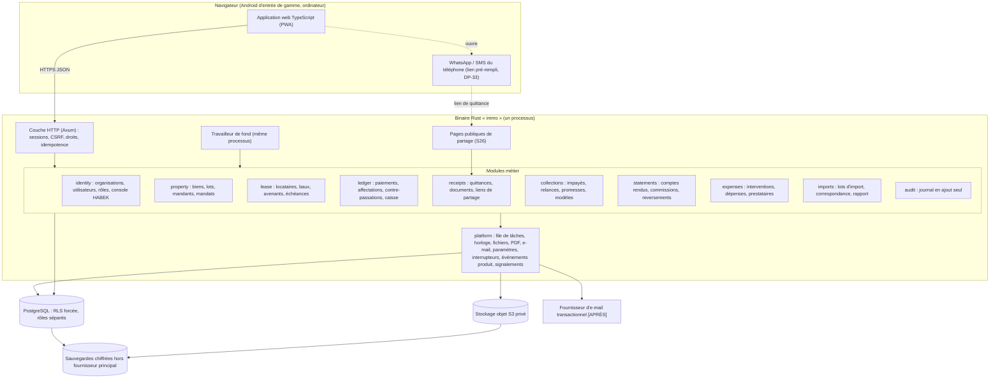
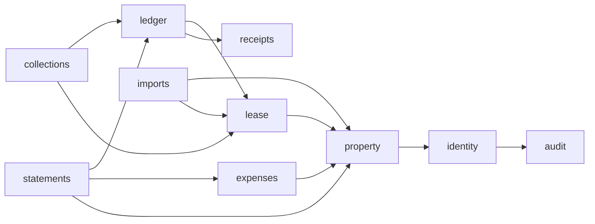

# Immo Suite — Architecture

| Champ | Valeur |
|---|---|
| Statut | Propriétaire de la pile, des modules, des règles d'architecture, des prototypes, de l'ordre de construction et de l'exploitation. Pile retenue par DP-56, base de données chez Neon par DP-55 ; tout autre choix de ce document reste une proposition [À valider] tant qu'il n'a pas d'entrée DP-xx dans `DECISIONS.md` |
| Date | 30/10/2026 |
| Dépend de | `DECISIONS.md` (état au 30/10/2026), dossier de cadrage v1.0 (§9, §11, §12, §15, §16, §18 à §21, §24), `DOMAINE.md` (R-001 à R-110, E-01 à E-48), `CONTEXTE.md`, `UI_UX_DESIGN.md`, `MAQUETTE.md`, `AUDIT_COHERENCE.md`, `AUDIT_COHERENCE_2.md`, `maquette/data/*.js` |
| Alimente | `DATABASE_SCHEMA.md`, `API_CONTRACTS.md`, `SECURITY.md`, `CODING_RULES.md`, `TESTING_QA.md`, `DEPLOYMENT.md`, `ROADMAP.md`, `CLAUDE.md` (section « À compléter après ARCHITECTURE.md ») |
| Version | 0.2 |

Légende des marqueurs ([PILOTE], [APRÈS], [À valider], [Hypothèse], [À VÉRIFIER AVEC UN JURISTE]) et hiérarchie en cas de conflit : voir `CLAUDE.md` (hiérarchie par sujet ; ce document est propriétaire de la pile et de l'exploitation, `DATABASE_SCHEMA.md` des tables et contraintes).

Règle de base, non négociable : les agences pilotes saisissent de vrais loyers. Quatre sujets sont donc toujours [PILOTE] : intégrité des écritures (paiements immuables, contre-passation, quittances numérotées sans trou), isolation entre organisations, sauvegardes avec restauration testée, journal d'audit des actions sensibles (R-007, R-008, qui conditionne la confiance dans les trois premiers).

## 1. Objectifs, hors-périmètre, qualités attendues

### 1.1 Objectifs

- Livrer vite une première version utilisable par des agences pilotes avec leurs vraies données : T1 puis T2 du dossier (§9.1, DP-29), T3 pendant le pilote.
- Corriger et ajouter souvent pendant le pilote sans casser les données déjà saisies.
- Observer ce que font réellement les pilotes (écrans utilisés, blocages, erreurs) sans traceur tiers.
- Rester exploitable par un développeur à environ 25 heures par semaine et le porteur du projet (DP-54), à coût d'infrastructure minimal.

### 1.2 Hors-périmètre de l'architecture

Repris de `CONTEXTE.md` (Exclusions du MVP) et du dossier §12.2 : microservices, Kubernetes, Redis, file de messages externe, moteur de recherche dédié, application native ou hors-ligne (F33, DP-05), IA (F37, règle d'or 11), API publique, multi-pays et multi-devises activés, paiement en ligne (F26, DP-32), API WhatsApp Business (F27, DP-33), comptabilité générale. Aucune détention de fonds (règle d'or 3, DP-08) : le système enregistre des encaissements faits ailleurs, il ne déplace jamais d'argent.

Le module « paiements et grand livre » de ce document est le **livre des encaissements locatifs** (paiements, affectations, contre-passations). Ce n'est pas un grand livre comptable au sens du plan comptable, exclu par le dossier (§10).

### 1.3 Qualités attendues, par priorité

| Rang | Qualité | Ce que cela impose | Mesure |
|---|---|---|---|
| 1 | Exactitude et traçabilité des écritures | Montants entiers, écritures en ajout seul, numérotation sans trou, audit dans la même transaction, cas E-01 à E-48 en tests automatiques | Zéro écart avec les cas de référence ; zéro trou de numérotation sous concurrence |
| 2 | Isolation entre organisations | `org_id` partout, sécurité au niveau des lignes (RLS) forcée, test d'étanchéité par point d'accès | Un test d'isolation manquant fait échouer le build (CLAUDE.md, règle d'or 4) |
| 3 | Utilisable sur connexion lente | Pages légères, réponses courtes, reprise sans doublon (R-042) | Budgets de la section 12 |
| 4 | Simplicité d'exploitation pour un développeur à temps partiel | Un binaire, une base, un stockage objet, pas d'autre brique | Déploiement et retour arrière en une commande ; restauration chronométrée |
| 5 | Capacité à évoluer vite pendant le pilote | Migrations rétrocompatibles, interrupteurs par organisation, paramètres plutôt que code spécifique | Mise en production possible plusieurs fois par semaine sans coupure notable |

En cas de conflit, le rang le plus faible cède. Exemple : une optimisation de performance qui affaiblit l'immuabilité est refusée.

## 2. Vue d'ensemble

### 2.1 Forme : monolithe modulaire

Un seul binaire Rust sert l'API, les pages publiques de partage (S26) et les fichiers statiques du front, et exécute les tâches de fond. Une seule base PostgreSQL. Un stockage objet compatible S3 pour les PDF et les documents. C'est la forme recommandée par le dossier (§12) et confirmée par DP-06.



### 2.2 Règles de frontière communes à tous les modules

- Chaque module est un module Rust avec une façade publique (`pub mod api`) : fonctions de service, types d'entrée et de sortie. Ses tables, requêtes et types internes sont privés (`pub(crate)` au plus dans le module).
- Un module ne lit ni n'écrit jamais les tables d'un autre module. Il passe par la façade de l'autre. Exception : les vues de lecture (`read models`) déclarées dans la section du module qui les possède.
- Toute fonction qui touche la base reçoit un `OrgTx` (transaction déjà liée à une organisation, section 5.3). Il n'existe pas d'accès base sans ce type, hors module `platform` et console HABEK.
- Une action métier = une transaction. L'écriture d'audit est dans la même transaction (R-008).
- Les orchestrations qui traversent plusieurs modules (exemple : générer les échéances puis affecter le crédit du bail) vivent dans une couche mince de cas d'usage (`use_cases`), pas dans un module. Cela évite les dépendances circulaires.
- Les dépendances autorisées forment un graphe sans cycle, vérifié en revue et par un test qui analyse les `use` entre modules [APRÈS] :



Tous les modules dépendent aussi de `platform` et `audit` (flèches omises).

### 2.3 Modules

Les noms entre parenthèses sont les collections de `maquette/data/*.js` couvertes. Les collections calculées de la maquette (`tableauDeBord`, `impayes`, `rappels`, `meta`, `scenarios`) ne sont pas des tables : ce sont des lectures calculées.

#### identity — identité et organisations (F01, F02, F40 partiel)

- **Responsabilités** : inscription, connexion, sessions, invitations (7 jours), réinitialisation du mot de passe, organisations et plans (R-082), adhésions et rôles, droits réglables (gestionnaire qui encaisse, importe, exporte), affectation des lots aux agents terrain et aux gestionnaires (R-081), accès support HABEK limité dans le temps (R-009), console HABEK.
- **Données possédées** : `organizations` (`organisation` : nom, plan, préfixe, ville, fuseau, devise, langue), `users`, `memberships` (`utilisateurs` : rôle, statut actif / invitation en attente / expirée), `invitations`, `sessions`, `login_attempts`, `role_settings` (`parametres.droits`), `unit_assignments`, `support_grants` (`parametres.accesSupport`), `platform_staff`.
- **Expose** : `current_actor(session) -> Actor { user_id, org_id, role, plan }`, `authorize(actor, Action) -> Result<(), Denied>` (matrice de `CONTEXTE.md`, un seul endroit), `assigned_units(actor)`, `begin_support_access(staff, org)`.
- **Dépendances autorisées** : `audit`, `platform`.

#### property — biens et lots, mandants et mandats (F04, F05)

- **Responsabilités** : biens, lots, usages et types (R-010 à R-013, R-093, R-094), statut du lot (vacant, occupé, en travaux, archivé), archivage (R-005, R-006), mandants et mandats (R-014 à R-016, R-069), avenants de taux.
- **Données possédées** : `properties` (`biens`), `units` (`lots` : référence, type, usage, statut, loyer de référence, activité autorisée), `owners` (`mandants`), `mandates` et `mandate_units` (`mandats` : taux, base, dates, lots), `mandate_rate_changes`.
- **Expose** : création et modification, `unit_status`, `active_mandate_for(unit, date)`, `units_without_mandate(owner, period)` (R-075).
- **Dépendances autorisées** : `identity`, `audit`, `platform`.
- **Note** : le statut « occupé » ou « vacant » est dérivé du bail en cours (R-013). Seul « en travaux » et « archivé » sont posés à la main. Le statut d'un lot est donc lu via `lease`, pas stocké en double.

#### lease — locataires, baux, échéances (F06, F07, F08, F20 simple, F23 [APRÈS])

- **Responsabilités** : fiches locataires (R-017 à R-019), baux et colocation, statuts (R-090, DP-24), avenants datés (R-023, R-091), dépôt de garantie simple (R-024, R-066), un seul bail en cours par lot (R-020), génération idempotente des échéances (R-027 à R-031), lignes exceptionnelles et arriérés (R-035, R-036).
- **Données possédées** : `tenants` (`locataires`), `leases` et `lease_tenants` (`baux.locataireIds`), `lease_amendments` (`baux.avenants`), `lease_commercial_terms` (`baux.commercial` : durée, indexation ; `tvaIncluse`), `installments` et `installment_lines` (`echeances`, `echeances.lignes`). Le préavis est porté par les colonnes `notice_given_on` et `departure_date` de `leases` (pas de table `lease_notices`) ; le dépôt de garantie par `security_deposit_events` (table prévue, non créée au pilote : `DATABASE_SCHEMA.md` §3).
- **Expose** : `active_lease_for(unit, date)`, `installments_of(lease)`, `generate_installments(org, today)`, `add_exceptional_line`, `lease_parties(lease)` pour la quittance.
- **Dépendances autorisées** : `property`, `identity`, `audit`, `platform`.
- **Note** : le statut d'une échéance (à venir, due, partielle, payée, en retard) n'est jamais stocké (R-034, DP-13, DP-27). Il est calculé à la lecture à partir des affectations et de la date du jour de l'organisation. Il dépend du temps : le stocker créerait le cache obsolète que R-034 interdit.

#### ledger — paiements et grand livre des encaissements (F09, F19 [APRÈS], F25 [APRÈS])

- **Responsabilités** : enregistrement idempotent des paiements (R-037 à R-046), affectation par défaut et ajustée (R-043, R-087), avance et crédit du bail (R-046, R-086), « payé par » (R-088), demandes de correction et contre-passation (R-047, R-048), journées de caisse et clôture (R-079, R-089) [APRÈS].
- **Données possédées** : `payments` (`paiements` de type paiement ou contre-passation), `allocations` (`paiements.affectations`), `correction_requests` (`demandesCorrection`), `idempotency_keys`, `cash_days` (`caisse`) [APRÈS].
- **Expose** : `record_payment(tx, cmd, idempotency_key) -> PaymentRecorded`, `reverse_payment(tx, payment, reason)`, `request_correction`, `paid_by_installment_line(lease)`, `unallocated_credit(lease)`, `apply_credit(tx, lease)`, `collected_in_period(scope, period)` pour les comptes rendus.
- **Dépendances autorisées** : `lease`, `receipts` (émission de la quittance dans la même transaction), `identity`, `audit`, `platform`.

#### receipts — quittances et documents (F10, F16 [APRÈS])

- **Responsabilités** : numérotation sans trou (R-050, DP-15, DP-37), instantané immuable du contenu de la quittance (R-051, R-052, R-053), annulation et rectificative (R-096, DP-38), rendu PDF A4 et A5 (R-056) par tâche de fond avec nouvel essai (R-049), liens de partage expirables (R-054), historique des envois (R-055), documents rattachés à un bien, lot, locataire, bail ou intervention (F16).
- **Données possédées** : `receipt_counters`, `receipts` (`quittances` : numéro, ventilation, montant en lettres, solde restant, avance), `receipt_cancellations`, `receipt_files` (PDF, empreinte SHA-256), `receipt_sends` (`quittances.envois`), `share_links`, `documents` et `document_links` (`documents.objets`) [APRÈS].
- **Expose** : `issue(tx, ReceiptDraft) -> Receipt` (appelé par `ledger`, ne lit jamais les tables de `ledger`), `cancel(tx, receipt, by_reversal)`, `render_html(receipt)`, `create_share_link`, `resolve_share_link(token)` pour S26.
- **Dépendances autorisées** : `identity`, `audit`, `platform`.

#### collections — impayés et relances (F11, F12, F17 partiel, F22 [APRÈS])

- **Responsabilités** : tableau des impayés et tranches d'ancienneté (R-057, R-058, DP-12), filtres par bien, mandant, gestionnaire, usage (F11), rappels à J−3 (R-097, DP-40), relances assistées et journalisées (R-060 à R-064), promesses et alerte de promesse non tenue (R-059, R-065, DP-36), modèles de messages.
- **Données possédées** : `reminders` (`relances`), `promises` (`promesses`), `message_templates` (`modelesRelance`, `parametres.modelesMessages`), `tasks` et `notifications` (`agenda`, `notifications`) [APRÈS] (tables prévues, non créées : `DATABASE_SCHEMA.md` §3).
- **Expose** : `arrears(scope, today)` (lecture calculée, `impayes`), `reminders_due(today)` (`rappels`), `render_template(template, context)` avec refus des variables inconnues (R-064), `log_reminder`, `record_promise`.
- **Dépendances autorisées** : `ledger` (lecture), `lease`, `property` (filtres), `identity`, `audit`, `platform`.
- **Note** : « promesse non tenue » est calculée (date promise dépassée sans paiement), pas écrite par une tâche. Pas de tâche à surveiller pour ce cas.

#### statements — comptes rendus et reversements (F13, plan Agence)

- **Responsabilités** : production du relevé par mandant et période, base de commission (R-068, DP-14, DP-16), dépenses imputées (R-084), net à reverser (R-070), validation et gel (R-073, R-074), versions et réouverture (R-083, DP-17), reversement immuable (R-077), blocage si lot sans mandat (R-075), un loyer dans un seul relevé (R-072).
- **Données possédées** : `statements` (`releves`), `statement_versions` (instantané complet des lignes, totaux, impayés), `statement_payment_links` (garantit R-072), `payouts` (`releves.reversement`).
- **Expose** : `preview(owner, period)`, `validate`, `reopen(reason)`, `record_payout`, `render_pdf(version)`.
- **Dépendances autorisées** : `ledger` (lecture), `expenses` (lecture), `property`, `lease` (impayés), `identity`, `audit`, `platform`.
- **Note** : le statut « à produire » de la maquette (`releves.statut = a_produire`) n'est pas un état de `DOMAINE.md`. C'est l'absence de relevé pour une période échue, calculée à la lecture.

#### expenses — dépenses et travaux (F15 minimal en T2, F15 complet [APRÈS])

- **Responsabilités** : interventions et dépenses par lot, payeur et imputation par défaut (R-078, R-084, DP-18), changement d'imputation tracé, prestataires, interventions antérieures à l'usage d'Immo Suite (`horsHistorique` de la maquette).
- **Données possédées** : `interventions` (`interventions`), `providers` (`prestataires`), `expense_imputation_changes`.
- **Expose** : `imputable_expenses(owner, period)`, `unit_history(unit)`.
- **Dépendances autorisées** : `property`, `identity`, `audit`, `platform`.

#### imports — reprise des données (F14)

- **Responsabilités** : téléversement CSV et XLSX, proposition de correspondance des colonnes, zone de préparation, aperçu (valides, avertissements, erreurs par numéro de ligne, doublons), confirmation, rapport, annulation tant que rien n'est utilisé (R-080, E-20, E-21).
- **Données possédées** : `import_batches` (`imports`), `import_rows` (lignes brutes et résultat de validation, `importExemple`), `import_mappings` (correspondances mémorisées par organisation).
- **Expose** : `upload`, `propose_mapping`, `preview`, `confirm`, `cancel`.
- **Dépendances autorisées** : `property`, `lease` (création par leurs façades), `identity`, `audit`, `platform`.
- **Note** : chaque ligne créée par un import porte `import_batch_id`. C'est ce qui rend l'annulation exacte et vérifiable.

#### audit — journal d'audit (F03)

- **Responsabilités** : écriture en ajout seul de toute action sensible (qui, quoi, objet, avant, après, quand, adresse IP), lecture filtrée (S21), lignes « accès support » (R-009).
- **Données possédées** : `audit_log` (`audit`).
- **Expose** : `record(tx, AuditEntry)`, `query(filters)`.
- **Dépendances autorisées** : `platform` seulement. Tous les modules en dépendent.

#### platform — services techniques (sans règle métier)

`Clock` (date du jour par organisation, injectable en test), file de tâches PostgreSQL, stockage de fichiers, moteur PDF derrière une interface, envoi d'e-mails [APRÈS], paramètres par organisation, interrupteurs de fonctionnalités, événements produit, signalements « Signaler un problème », suivi des erreurs. Détail aux sections 3, 8 et 10.

## 3. Choix de pile

Chaque choix est une décision proposée. Aucune n'est prise : voir « Décisions à enregistrer dans DECISIONS.md ».

### 3.1 Framework web Rust

- **Contexte** : DP-06 fixe Rust et cite Axum, Tokio, SQLx comme recommandation « à figer dans ARCHITECTURE ». Équipe de deux, itération rapide recherchée.
- **Options** : (a) Axum ; (b) Actix Web.
- **Choix recommandé** : Axum [À valider].
- **Raison** : construit sur Tokio, Tower et Hyper, donc couches de sécurité et de limitation réutilisables (`tower-http` : compression, délais, en-têtes). Extracteurs typés qui rendent impossible d'oublier l'acteur ou la transaction d'organisation dans un gestionnaire. Écosystème le plus actif côté Tokio. Actix Web est aussi rapide et mûr, mais son modèle d'acteurs et son écosystème propre n'apportent rien ici.
- **Conséquences** : Tokio comme exécuteur unique, `tower-http` pour compression gzip et brotli (connexion lente), délais et taille maximale des requêtes. Un extracteur `OrgTx` (section 5.3) et un extracteur `IdempotencyKey`.

### 3.2 Accès à la base

- **Contexte** : code financier ; on veut des erreurs SQL détectées avant la production, et la maîtrise exacte des requêtes (verrous, `SET LOCAL`, contraintes).
- **Options** : (a) SQLx, SQL écrit à la main, vérifié à la compilation ; (b) un ORM (Diesel ou SeaORM).
- **Choix recommandé** : SQLx [À valider].
- **Raison** : les requêtes critiques (compteur de quittances, verrou par bail, contraintes d'exclusion) s'écrivent en SQL de toute façon. SQLx vérifie le SQL contre le schéma (`query!`) et fonctionne hors connexion en CI (`cargo sqlx prepare`). Un ORM cache précisément ce qu'on doit contrôler.
- **Conséquences** : dossier `.sqlx/` versionné ; la CI échoue si une requête ne correspond plus au schéma. Migrations SQLx (section 8.1). Requêtes rangées dans chaque module, jamais dans les gestionnaires HTTP.

### 3.3 PostgreSQL

- **Contexte** : déjà retenu (dossier §12, DP-06). Reste la version et la façon de l'exploiter.
- **Options** : (a) PostgreSQL managé chez l'hébergeur, avec restauration à un instant donné (PITR) ; (b) PostgreSQL installé sur le serveur applicatif, sauvegardes outillées par l'équipe.
- **Décision** (DP-55) : (a) PostgreSQL managé **chez Neon**, version majeure 16 ou plus récente. Extensions requises : `btree_gist` (contrainte « un seul bail en cours », section 4.7) ; `pg_trgm` [APRÈS] (recherche insensible aux accents avec `unaccent`). `pgcrypto` n'est pas nécessaire : `gen_random_uuid()` et `sha256()` sont natifs, le chiffrement des champs est applicatif (`DATABASE_SCHEMA.md` §11.2 A3).
- **Raison** : les sauvegardes et la restauration sont [PILOTE] et l'équipe est d'un développeur à temps partiel. Un service managé fournit le journal des transactions archivé (perte de données de quelques minutes au plus) sans outillage à maintenir. Surcoût de l'ordre de quelques dizaines d'euros par mois [Hypothèse, à vérifier chez l'hébergeur]. L'option (b) reste possible si le budget l'impose, avec un outil de sauvegarde continue vers le stockage objet ; elle ajoute une charge d'exploitation et un risque d'erreur humaine.
- **Conséquences** : à vérifier sur Neon au prototype (b) [À vérifier] : création des rôles `immo_app` et `immo_platform` **en SQL, sans `BYPASSRLS`** (les rôles créés par la console ou l'API de Neon reçoivent `BYPASSRLS`, `DATABASE_SCHEMA.md` §6.9), activation de `btree_gist`, restauration sur une nouvelle branche ou instance, durée d'historique du plan retenu (de 6 heures à 30 jours selon le plan : l'objectif de 30 jours de la section 10.4 en dépend), région la plus proche de Ouagadougou, mise en veille automatique désactivée en production. Une sauvegarde logique quotidienne indépendante est faite en plus (section 10.4). Le serveur applicatif et le stockage objet restent à choisir (décision n° 5).

### 3.4 Structure du dépôt

- **Contexte** : un développeur (assisté par Claude Code), un backend Rust, un front TypeScript, des contrats d'API partagés. Les documents vivent à la racine de ce dossier. Le dossier contient aussi des productions marketing (`film/`, `flyer/`, `infographie/`, `logo/`, `site/`, avec des environnements Python `.venv`).
- **Options** : (a) un seul dépôt (monorepo) ; (b) deux dépôts, backend et front.
- **Choix recommandé** : (a) monorepo [À valider].
- **Raison** : un changement d'API, sa migration et l'écran correspondant partent dans le même commit et la même revue. Un seul pipeline de CI. Le client TypeScript est généré depuis le contrat OpenAPI du même commit.
- **Conséquences** : structure proposée :

```text
Immo Suite/                    racine du dépôt (documents actuels conservés à la racine)
  Cargo.toml                   espace de travail Rust
  crates/
    domain/                    règles pures sans E/S : Fcfa, dates, affectation, commission,
                               montant en lettres, format du numéro, statut d'échéance
    app/                       modules (identity, property, lease, ledger, receipts,
                               collections, statements, expenses, imports, audit),
                               use_cases/, platform/
    server/                    binaire « immo » : HTTP (Axum), CLI, travailleur de fond
  migrations/                  migrations SQLx, en avant seulement
  templates/                   gabarits de quittance et de compte rendu (moteur PDF retenu)
  web/                         front TypeScript (Vite), tokens CSS copiés de UI_UX_DESIGN.md
  seeds/demo/                  scénario de l'organisation de démonstration (section 8.5)
  tests/fixtures/              fichiers d'import réalistes, cas E-01 à E-48
  ops/                         Dockerfile, configuration du proxy, scripts de sauvegarde
  maquette/                    inchangé (référence visuelle)
```

  Le crate `domain` ne dépend ni de SQLx ni de Tokio : les règles d'argent se testent sans base, vite, et par propriétés (R-044). Les dossiers marketing et les `.venv` sont exclus du dépôt ou déplacés (voir Questions ouvertes).

### 3.5 Front TypeScript

- **Contexte** : décision ouverte n° 6. Équipe déjà formée à React et TypeScript. Budget de `UI_UX_DESIGN.md` : 150 Ko de JavaScript compressé au premier chargement, LCP ≤ 3 s en « 4G lente » avec processeur ralenti 4×. Tokens CSS déjà écrits (`maquette/css/tokens.css`).
- **Options** : (a) React + Vite, application monopage ; (b) Svelte 5 + Vite (avec ou sans SvelteKit en mode statique).

Critères pesés (pondération proposée [À valider], notes de 1 à 5) :

| Critère | Poids | React | Svelte | Commentaire |
|---|---|---|---|---|
| Compétences de l'équipe | 30 % | 5 | 2 | L'équipe connaît React ; Svelte demande un apprentissage pendant le pilote |
| Poids des pages | 25 % | 3 | 5 | React et React DOM pèsent de l'ordre de 45 Ko compressés [Hypothèse, à mesurer] ; le runtime Svelte est de quelques Ko. Les deux tiennent dans 150 Ko avec discipline |
| Écosystème de composants accessibles | 20 % | 5 | 3 | React : primitives accessibles éprouvées (dialogue, feuille, onglets, liste déroulante) ; Svelte : offre plus jeune |
| Accessibilité atteignable | 15 % | 4 | 4 | Dépend surtout du code ; les deux permettent WCAG 2.1 AA |
| Réutilisation des tokens de la maquette | 10 % | 5 | 5 | Variables CSS : identique dans les deux cas |
| **Total pondéré** | | **4,35** | **3,55** | |

- **Choix recommandé** : React + Vite + TypeScript strict, application monopage servie par le binaire Rust [À valider, ferme la décision n° 6].
- **Raison** : la vitesse de l'équipe pendant le pilote prime, et le budget de poids reste tenable. Garde-fou : si le budget de 150 Ko est dépassé malgré le découpage par écran, Preact avec sa couche de compatibilité React se substitue sans réécriture des écrans.
- **Conséquences** :
  - Dépendances limitées et listées : routeur, client HTTP généré depuis OpenAPI, primitives accessibles pour dialogue, feuille du bas et onglets. Pas de bibliothèque de composants complète, pas de CSS-in-JS : CSS simple avec les tokens.
  - Découpage par écran (`import()` dynamique) : l'écran Encaisser (S04) se charge seul au premier accès du caissier.
  - Contrôle du poids en CI : le build échoue au-delà du budget.
  - Pas de rendu côté serveur : il imposerait un serveur Node en production. La page publique S26 est un HTML minimal rendu par Rust, sans JavaScript applicatif, pour un locataire sur un téléphone lent.

### 3.6 Application installable (PWA)

- **Contexte** : recommandée par le dossier (§10, §12), non décidée (`DECISIONS.md`, Questions ouvertes). DP-05 exclut le hors-ligne.
- **Options** : (a) PWA installable avec cache de la coquille applicative seulement ; (b) simple site web, sans service worker.
- **Choix recommandé** : (a) [À valider]. Le service worker met en cache les fichiers statiques versionnés (HTML de base, JS, CSS, icônes). Il ne met **jamais** en cache une réponse d'API et ne met jamais en file une écriture hors-ligne.
- **Raison** : au deuxième passage, l'application s'ouvre sans retélécharger les 200 Ko ; icône sur l'écran d'accueil Android. Aucune synchronisation, donc aucun risque sur les écritures.
- **Conséquences** :
  - La reprise après coupure (R-042, principe 8 de `UI_UX_DESIGN.md`) passe par la clé d'idempotence et le brouillon gardé dans l'écran, pas par le service worker.
  - Risque d'anciennes versions du front en circulation : chaque réponse d'API porte la version minimale de client acceptée ; en dessous, bandeau « Une mise à jour est disponible » et rechargement. Toute évolution d'API reste rétrocompatible au moins une version (section 8.1).
  - [PILOTE] pour la mise à jour forcée ; l'installation sur l'écran d'accueil est [APRÈS].

### 3.7 Style d'API

- **Contexte** : API interne, un seul client (le front), contrats à tenir pendant des mises à jour fréquentes.
- **Options** : (a) REST JSON décrit par OpenAPI généré depuis le code Rust ; (b) REST JSON sans contrat formel.
- **Choix recommandé** : (a) [À valider].
- **Raison** : le contrat généré depuis le code ne diverge pas ; le client TypeScript généré attrape au build un champ renommé. GraphQL et gRPC restent écartés (dossier §12).
- **Conséquences** :
  - Erreurs au format `application/problem+json` avec un code métier stable (`payment.external_ref_duplicate`, `lease.overlap`, `auth.forbidden`) et un identifiant de requête court affiché comme « code d'incident » (`UI_UX_DESIGN.md`, État d'erreur).
  - Une ressource d'une autre organisation répond 404 « Introuvable », jamais 403 (R-004), et la tentative est journalisée.
  - Pas de numéro de version dans les adresses tant que l'API n'est pas publique (dossier §12). Règles de compatibilité en section 8.1.
  - `API_CONTRACTS.md` reprendra le contrat ; le fichier OpenAPI généré est versionné et sa différence est relue en revue.

### 3.8 Authentification

- **Contexte** : identifiant = téléphone ou e-mail ; mot de passe ; pas de fournisseur d'identité externe (dossier §12, F01). Comptes de support HABEK qui voient des données réelles.
- **Options** : (a) sessions côté serveur stockées dans PostgreSQL, cookie `HttpOnly` ; (b) jetons JWT sans état.
- **Choix recommandé** : (a) [À valider].
- **Raison** : révocation immédiate (désactivation d'un utilisateur, changement de rôle effectif sans reconnexion, F02), pas de secret de signature à faire tourner, rien de plus à exploiter.
- **Conséquences** :
  - [PILOTE] Mots de passe hachés avec argon2id ; cookie `Secure`, `HttpOnly`, `SameSite=Lax` ; jeton CSRF exigé sur toute requête qui écrit ; identifiant de session aléatoire stocké haché ; expiration après inactivité ; limitation des tentatives par identifiant et par adresse IP, comptée dans PostgreSQL (pas de Redis).
  - [PILOTE] Double authentification TOTP obligatoire pour les comptes HABEK de la console (F39/F40 : « comptes nominatifs, double authentification »).
  - [PILOTE] Double authentification TOTP du gérant (ou propriétaire) obligatoire **avant la bascule de son organisation en `live`** (DP-68, `SECURITY.md` §3.4). Écart assumé par rapport au dossier §12 (option P1).
  - Réinitialisation du mot de passe : lien à usage unique valable 15 minutes, généré par le gérant ou le support HABEK et transmis par l'utilisateur lui-même (WhatsApp) (DP-68). Pas de code envoyé par SMS ou e-mail au pilote ; la passerelle SMS vient [APRÈS]. Inscription publique fermée : les organisations sont créées par la console.
  - Invitations : lien à usage unique valable 7 jours, copiable dans WhatsApp. Aucun e-mail requis au pilote.

### 3.9 Tâches en arrière-plan

- **Contexte** : génération quotidienne des échéances (R-029), rendu PDF avec nouvel essai (R-049), purge des sessions, contrôles de sauvegarde. Pas de Redis (dossier §12).
- **Options** : (a) file de tâches dans une table PostgreSQL, travailleur dans le binaire, prise de tâche par `SELECT … FOR UPDATE SKIP LOCKED` ; (b) bibliothèque Rust de file de tâches adossée à PostgreSQL.
- **Choix recommandé** : (a) écrite par l'équipe (quelques centaines de lignes) [À valider].
- **Raison** : la propriété clé est l'**insertion de la tâche dans la même transaction** que l'écriture métier. Si le paiement est validé, la tâche de rendu de sa quittance existe forcément ; si la transaction échoue, aucune tâche orpheline. Le code reste lisible et sans dépendance qui peut changer d'API.
- **Conséquences** :
  - Table `jobs` : type, charge utile, organisation, état, tentatives, prochain essai (attente croissante), dernière erreur, clé d'unicité facultative (une seule génération d'échéances par organisation et par jour).
  - Planificateur interne : une boucle qui insère les tâches périodiques avec leur clé d'unicité. Plusieurs instances du binaire ne créent pas de doublon.
  - Toute tâche est idempotente et s'exécute dans un `OrgTx` de l'organisation concernée.
  - Alerte si une tâche échoue cinq fois ou si une quittance attend son PDF depuis plus de 10 minutes [valeurs proposées].

### 3.10 Stockage des fichiers

- **Contexte** : PDF des quittances et des comptes rendus, logos, signatures, documents [APRÈS]. Dossier §11.5 et §12 : compatible S3, privé, adresses signées.
- **Options** : (a) stockage objet compatible S3 de l'hébergeur ; (b) disque du serveur.
- **Choix recommandé** : (a) [À valider], derrière une interface `FileStore` avec une implémentation disque pour le développement local.
- **Raison** : le disque du serveur se perd avec le serveur et complique la sauvegarde (dossier §12).
- **Conséquences** :
  - Seau privé, clés préfixées par organisation (`org/{org_id}/receipts/{receipt_id}.pdf`), adresses signées de quelques minutes.
  - Versionnage du seau activé et réplication quotidienne vers un second fournisseur [PILOTE] : un PDF de quittance est une preuve remise au locataire.
  - Empreinte SHA-256 de chaque PDF enregistrée en base (entité Quittance, §15.2).
  - Le PDF **effectivement émis** est conservé tel quel et fait foi (DP-71) : il n'est jamais régénéré pour le remplacer. Sa clé de stockage, sa date de génération et son SHA-256 sont en base (`receipt_files`, ajout seul) ; l'objet est écrit « créer seulement ». **La perte d'un PDF émis est une perte de preuve**, pas seulement un fichier à refaire : l'instantané ne permet de produire qu'une **copie** clairement indiquée comme telle, jamais l'original. Tous les fichiers sont dans le stockage objet, jamais dans PostgreSQL (DP-70).

### 3.11 Envoi d'e-mails

- **Contexte** : dossier §11.5 (invitations, résumés). Les utilisateurs s'identifient souvent par téléphone. Au MVP, quittances et relances passent par des liens WhatsApp pré-remplis (DP-33).
- **Options** : (a) fournisseur d'e-mail transactionnel par SMTP ou API ; (b) aucun e-mail au pilote.
- **Choix recommandé** : (b) au premier pilote, puis (a) [APRÈS] [À valider].
- **Raison** : aucune fonction de T1 ou T2 n'exige l'e-mail si les invitations et réinitialisations passent par un lien copiable. Une brique de moins à configurer (domaine expéditeur, réputation, désabonnement).
- **Conséquences** : interface `Mailer` créée vide ; les e-mails internes à l'équipe HABEK (alertes, signalements) passent par le canal d'alerte de la section 10.3. Le résumé quotidien du gérant (F22) arrive avec l'e-mail.

## 4. Règles d'architecture issues du domaine

### 4.1 Montants

- [PILOTE] Type Rust `Fcfa(i64)` (nouveau type, pas d'alias) ; colonne PostgreSQL `BIGINT`. Aucun `f32`, `f64`, `NUMERIC` ni `DECIMAL` pour un montant (R-001). Le type `Fcfa` n'implémente pas la multiplication par un flottant ; seules addition, soustraction et comparaison sont fournies, avec débordement vérifié.
- Contraintes en base : `CHECK (amount > 0)` sur un paiement (R-037), avec une borne supérieure de 999 999 999 en valeur absolue (R-001, DP-56 ; `DATABASE_SCHEMA.md` §1.2), `CHECK (amount < 0)` sur une contre-passation, `CHECK (rent > 0)` sur un bail (R-022).
- JSON : entier. Le front n'effectue aucun calcul d'argent ; il affiche ce que le serveur renvoie (aperçu d'affectation compris, calculé par l'API).
- Taux de commission : entier en centièmes de point, soit 750 pour 7,5 %, `CHECK (rate BETWEEN 0 AND 10000)` (R-015) [À valider : précision de deux décimales suffisante].

### 4.2 Arrondis

- Une seule opération arrondit : la commission (DP-14, R-068), une fois par relevé et par mandant.
- Calcul entier, sans flottant : `commission = (base × taux + 5 000) / 10 000` (division entière) pour une base positive. E-26 : 333 333 × 750 = 249 999 750 ; + 5 000 ; ÷ 10 000 = 25 000. E-16 : 100 000 × 800 → 8 000.
- Base négative possible si les contre-passations de la période dépassent les encaissements : règle d'arrondi non définie par DP-14 (voir Questions ouvertes). En attendant, le relevé refuse la production avec un message explicite.
- Montant en lettres (R-053) : fonction du crate `domain`, indépendante du moteur PDF, testée de 0 à 999 999 999 (cas E-11, « un million deux cent cinquante mille »). Accords de « vingt » et « cent », « mille » invariable. Orthographe traditionnelle, comme la maquette [À valider : traditionnelle ou rectifications de 1990 ; formulation « francs CFA », décision n° 12].

### 4.3 Paiements immuables et contre-passation

- [PILOTE] Les tables d'écriture sont en **ajout seul, garanti par PostgreSQL** et pas seulement par le code : le rôle applicatif n'a ni `UPDATE` ni `DELETE` sur les 25 tables d'écriture listées en `DATABASE_SCHEMA.md` §4.2 (dont `payments`, `allocations`, `receipts`, `receipt_cancellations`, `payouts`, `statement_versions`, `reminders` et `audit_log`), qui portent en plus un déclencheur d'interdiction (DP-56, décision n° 34). Un test d'intégration vérifie que ces commandes échouent (dossier F03, critère « une requête qui tente de modifier une ligne d'audit est rejetée »).
- Les statuts « Validé / Corrigé » d'un paiement et « Émise / Annulée » d'une quittance sont **dérivés** de l'existence d'une écriture liée (contre-passation, annulation), pas d'une colonne modifiée.
- Contre-passation (R-048, DP-38, E-38) : une ligne `payments` de type `reversal`, montant opposé, `reverses_payment_id` unique (un paiement n'est contre-passé qu'une fois), motif obligatoire, auteur gérant ; des affectations négatives qui annulent exactement celles d'origine ; une ligne `receipt_cancellations` pour la quittance d'origine. Le paiement de remplacement est un paiement ordinaire dont la quittance est marquée rectificative et référence la quittance annulée (R-096). La contre-passation n'a pas de quittance propre (choix de la maquette, `maquette/NOTES.md`).
- Sérialisation par bail : toute écriture d'argent sur un bail prend d'abord `pg_advisory_xact_lock` sur l'identifiant du bail. Deux caissiers qui encaissent le même locataire en même temps sont traités l'un après l'autre (dossier §19, « deux caissiers sur le même locataire »). La somme des affectations est relue sous ce verrou avant insertion (R-044).
- Capturer dès le premier jour les données non reconstituables plus tard : date du paiement et instant de saisie (DP-23, R-089, nécessaires à la clôture de caisse livrée en T3), auteur, mode, « payé par » (R-088), adresse IP dans l'audit.

### 4.4 Numérotation des quittances sans trou

**Pourquoi une séquence PostgreSQL ne suffit pas.**

- `nextval()` n'est pas annulé par un `ROLLBACK` : un paiement refusé après l'attribution du numéro (contrôle métier, coupure, erreur PDF synchrone, verrou) laisse un trou. C'est le comportement documenté des séquences, voulu pour la performance.
- Une séquence est globale ; il en faudrait une par organisation et par année (DP-15), créée à la volée par une commande DDL, hors du modèle de migrations.
- L'ordre d'attribution par `nextval()` n'est pas l'ordre de validation : deux transactions concurrentes peuvent valider dans l'ordre inverse de leurs numéros.
- Le cache de séquence et la reprise après panne peuvent sauter des valeurs.

**Mécanisme proposé** [PILOTE] :

1. Table `receipt_counters (org_id, series, year, last_number, PRIMARY KEY (org_id, series, year))`, sous RLS comme le reste. `series` vaut `trial` en phase `setup` et `official` après la bascule (DP-61).
2. Dans la **même transaction** que la validation du paiement (DP-15), juste avant l'insertion de la quittance :

```sql
INSERT INTO receipt_counters (org_id, series, year, last_number)
VALUES (current_org_id(), $1, $2, 1)
ON CONFLICT (org_id, series, year)
DO UPDATE SET last_number = receipt_counters.last_number + 1
RETURNING last_number;
```

3. La ligne du compteur reste verrouillée jusqu'à la fin de la transaction. Une seconde validation de la même organisation attend. Si la première échoue, sa mise à jour est annulée avec elle : pas de trou. Si elle réussit, la seconde lit la valeur suivante : numéros consécutifs (R-050, E-10).
4. Le numéro affiché est construit par le crate `domain` : `{préfixe}-{année sur 4 chiffres}-{séquence sur 6 chiffres}` (DP-37). En série `trial`, le préfixe est `ESSAI-` et le filigrane « ESSAI » (DP-61). Contrainte d'unicité `(org_id, series, year, sequence)` sur `receipts` en filet de sécurité.
5. Le verrou est tenu peu de temps : le compteur est pris en dernier, après tous les contrôles métier ; le rendu PDF n'est **pas** dans la transaction (tâche de fond, section 3.9). La contention ne touche qu'une organisation à la fois.
6. Le contenu de la quittance (parties, lot, période, ventilation, solde restant, avance, montant en lettres, « payé par », mention TVA incluse) est enregistré comme instantané dans la même transaction. Le PDF est un rendu de cet instantané : un échec de rendu ne touche ni le paiement ni le numéro (R-049).
7. Contrôle continu [PILOTE] : une requête de vérification « aucun trou par organisation, série et année » tourne chaque nuit et alerte au moindre écart.

**Vérifié au prototype (c), 31/10/2026 (DP-79)** : 19 110 quittances sur Neon, 0 trou, 0 doublon, 0 interblocage, 10 % d'annulations forcées sans trace ; ordre des verrous : clé d'idempotence, verrou du bail, compteur ; `UPDATE` accordé à `immo_app` sur `receipt_counters` et `idempotency_keys`.

L'année de la séquence est l'année de l'émission (date de validation au fuseau de l'organisation), comme dans la maquette où le numéro suit la date de saisie (`maquette/NOTES.md`) : décision DP-61. Un paiement du 31/12 saisi le 02/01 reçoit donc un numéro de la nouvelle année.

### 4.5 Idempotence des enregistrements de paiement

- [PILOTE] Le front crée une clé d'idempotence (UUID v4) à l'ouverture du formulaire Encaisser (`UI_UX_DESIGN.md`, Champs et formulaires) et la réutilise à chaque nouvel essai. En-tête `Idempotency-Key` obligatoire sur `POST /payments` et sur toute écriture d'argent.
- Table `idempotency_keys (org_id, key, route, user_id, request_hash, response_status, response_body, created_at)`, unique sur `(org_id, key)` ; la colonne `route` empêche qu'une même clé serve deux routes différentes (`DATABASE_SCHEMA.md` §11.2 A11), insérée **dans la même transaction** que le paiement.
- Cas traités :
  - double clic, deux requêtes simultanées : la seconde bute sur l'unicité, attend la fin de la première, puis renvoie la réponse enregistrée (même paiement, même numéro de quittance) ;
  - coupure réseau après validation, réponse perdue : le nouvel essai renvoie la réponse enregistrée, rien n'est créé (E-07) ;
  - coupure avant validation : la transaction n'a rien écrit, le nouvel essai crée le paiement normalement ;
  - même clé, contenu différent (`request_hash` différent) : refus 422 explicite, aucun effet.
- Conservation des clés : 30 jours [valeur proposée], purge par tâche de fond.
- Doublon de référence externe (R-041) : contrôle distinct de l'idempotence, fait sous verrou consultatif sur `(org, mode, référence)` et en ignorant les paiements contre-passés (un paiement corrigé puis ressaisi garde sa référence mobile money). Avertissement qui bloque jusqu'à confirmation explicite (R-102, DP-58). Pas d'index unique en base : le contrôle est dans le service.

### 4.6 Dates et fuseau

- Dates métier (échéance, paiement, période, début et fin de bail) : type `date` en base, `civil::Date` côté Rust, sans heure ni fuseau.
- Instants (saisie, audit, sessions) : `timestamptz`, stockés en UTC.
- « Aujourd'hui » se calcule toujours avec le fuseau de l'organisation (paramètre `Africa/Ouagadougou`, R-002, R-003), par le service `Clock`. Jamais `CURRENT_DATE` en SQL, jamais l'heure du serveur. Même si le fuseau vaut UTC+0 aujourd'hui, le code ne repose pas sur cette coïncidence (préparation de Bobo-Dioulasso sans effet, de la sous-région si un jour).
- Bibliothèque de dates avec base de fuseaux IANA embarquée [À valider : `jiff` ou `chrono` avec `chrono-tz`].
- `Clock` est injectable : les tests et le scénario de démonstration fixent la date (vendredi 13/11/2026, `MAQUETTE.md`).

### 4.7 Un seul bail en cours par lot

- [PILOTE] Contrainte d'exclusion PostgreSQL, indépendante du code :

```sql
EXCLUDE USING gist (
  org_id WITH =, unit_id WITH =,
  daterange(start_date, effective_end, '[]') WITH &&
) WHERE (status IN ('active', 'notice', 'ended'))
```

  `effective_end` est une colonne générée de `leases` : la date de fin effective (résiliation ou départ du préavis), la date de fin ou l'infini (`DATABASE_SCHEMA.md` §4.1). Les brouillons ne comptent pas ; les baux terminés comptent, de sorte qu'un nouveau bail ne peut pas chevaucher un bail passé (DP-56, décision n° 41). Couvre R-020 et DP-39 ; le message utilisateur reste celui de `UI_UX_DESIGN.md`.
- L'activation refuse un lot « en travaux » (R-093) et un lot archivé ; contrôle dans le service, sous verrou du lot.
- Même principe pour R-014 (un seul mandat actif par lot) : contrainte d'exclusion sur `mandate_units`.

### 4.8 Génération des échéances

- Tâche quotidienne par organisation, à 00 h 05 au fuseau de l'organisation [valeur proposée], plus génération immédiate à l'activation d'un bail (R-028) et après un avenant de prolongation (E-35).
- Fenêtre : toutes les périodes dont la date d'échéance tombe d'ici 30 jours (R-029). Idempotence garantie par l'unicité `(lease_id, period)` (R-027) et `INSERT … ON CONFLICT DO NOTHING` : relancer la tâche ne crée rien (E-03).
- Montant : loyer et charges de l'avenant en vigueur à la date d'échéance (R-023, E-02). Une ligne par composante (loyer, charges) pour l'ordre d'affectation (R-087).
- Pas d'échéance après la fin effective du bail (R-030). Jour d'échéance absent : 1er du mois, signalé (R-031).
- Dans la même transaction (cas d'usage `generate_and_apply_credit`), le crédit du bail est affecté à l'échéance nouvellement créée (R-086, E-31).
- Une génération ratée ne bloque rien : nouvel essai, alerte HABEK, reprise au cycle suivant (F08, cas d'erreur).
- Jour d'échéance 29 à 31 dans un mois court : dernier jour du mois (R-098). Premier mois partiel : loyer entier (R-099). Bail activé avec une date de début passée : échéances générées à partir du mois d'activation (R-100). Règles marquées [à confirmer avec l'agence pilote à la découverte] (DP-58).

### 4.9 Autres règles transversales

- Statut d'échéance, ancienneté et tranches (R-032, R-033, R-058, R-095) : une seule fonction du crate `domain`, appelée par toutes les lectures. Le tableau de bord, la liste des impayés, la fiche locataire et le relevé utilisent la même fonction : les totaux concordent par construction (contrôle n° 20 de la maquette).
- Documents figés : la quittance et chaque version validée d'un relevé sont des instantanés complets (lignes, totaux, textes, paramètres d'organisation au moment de l'émission). Changer un paramètre (en-tête, mentions) ou une règle plus tard ne modifie jamais un document émis (R-074).
- Archivage logique : colonnes `archived_at`, `archived_by` ; aucune suppression physique de données métier (R-005), hors annulation d'import (R-080) et hors purge d'une organisation en phase de reprise (section 8.6).
- Droits : la matrice de `CONTEXTE.md` est codée une seule fois (`identity::authorize`), vérifiée côté serveur à chaque action (R-081). Un test par couple rôle × action, généré à partir de la matrice (dossier §19). L'agent terrain est limité à ses lots par un filtre de portée appliqué dans les lectures de `collections`, `lease` et `property`.

## 5. Multi-locataire

### 5.1 Principes

- [PILOTE] Base partagée, colonne `org_id NOT NULL` sur toute table métier, y compris tables d'association, compteurs, tâches, événements produit, fichiers (dossier §12, R-004).
- Clés étrangères composites `(org_id, id)` entre tables métier : une ligne ne peut pas référencer une ligne d'une autre organisation, même par erreur de code.
- Identifiants : UUID générés par le serveur, non devinables, jamais réutilisés.
- Tables globales, sans `org_id` : `users`, `sessions`, `login_attempts`, `password_resets`, `platform_staff`, `platform_events`, `purge_order` et les tâches de plateforme. Elles ne contiennent aucune donnée métier ; la liste de référence est `DATABASE_SCHEMA.md` §6.5.

### 5.2 Deux barrières

1. **Code** : chaque requête filtre explicitement `org_id` (lisibilité, plans d'exécution, index).
2. **PostgreSQL** : sécurité au niveau des lignes (RLS) activée **et forcée** (`ALTER TABLE … FORCE ROW LEVEL SECURITY`) sur chaque table métier, avec une politique unique :

```sql
CREATE POLICY org_isolation ON <table>
  USING (org_id = current_org_id())
  WITH CHECK (org_id = current_org_id());
```

  `current_org_id()` lit `current_setting('app.org_id', true)` et renvoie `NULL` si la variable est absente. `org_id = NULL` n'est jamais vrai : sans contexte, une requête ne voit rien et n'écrit rien (échec fermé).

Rôles PostgreSQL [PILOTE] :

| Rôle | Usage | Droits |
|---|---|---|
| `immo_owner` | Propriétaire du schéma, migrations | Tout ; jamais utilisé par l'application en marche |
| `immo_app` | Application | Sans `BYPASSRLS`, non propriétaire des tables. `SELECT`, `INSERT` ; `UPDATE` seulement sur les tables non financières ; ni `UPDATE` ni `DELETE` sur les tables d'écriture (section 4.3) |
| `immo_platform` | Console HABEK, tâches de plateforme, tableau de bord interne | Lecture des tables de plateforme et des vues agrégées sans donnée personnelle ; accès aux données d'une organisation seulement via le même mécanisme que `immo_app`, après un accès support valide (R-009) |
| `immo_readonly` | Restauration de test, requêtes d'analyse ponctuelles | Lecture seule, sur l'environnement d'essai seulement ; une politique `USING (true)` créée uniquement par le jeu d'amorçage de l'essai lui permet de lire des tables à RLS forcée (`DATABASE_SCHEMA.md` §11.2 A12) |

Le propriétaire d'une table contourne la RLS par défaut : d'où `FORCE` et la séparation `immo_owner` / `immo_app`.

### 5.3 Circulation de l'identité d'organisation avec un pool de connexions

**Le piège.** Avec un pool (SQLx `PgPool`), une connexion physique sert successivement des requêtes de plusieurs organisations.

- `SET app.org_id = '…'` (ou `set_config(…, false)`) s'applique à la **session** de la connexion : la valeur survit au retour de la connexion dans le pool. La requête suivante, d'une autre organisation, hérite de la valeur si elle oublie de la redéfinir. C'est une fuite entre organisations silencieuse, qui n'apparaît qu'en concurrence.
- `SET LOCAL` hors d'un bloc de transaction est sans effet (avertissement seulement) : la valeur n'est jamais posée, la requête suivante ne voit rien, ou pire voit la valeur d'une session précédente si les deux formes sont mélangées.
- Une requête lancée directement sur le pool (`query(…).fetch_all(&pool)`) s'exécute dans sa propre transaction implicite, sans contexte.
- Avec `set_config(…, true)`, les variables sont locales à la transaction et restent compatibles avec un pooler externe en mode transaction (de type PgBouncer) ; seule la variante de session ne l'est pas. Aucun pooler n'est prévu au pilote (connexion directe à Neon, DP-55).

**La solution** [PILOTE] :

1. Toute requête applicative s'exécute dans une transaction explicite. La première instruction de la transaction est :

```sql
SELECT set_config('app.org_id', $1, true), set_config('app.user_id', $2, true);
```

   Le troisième argument `true` limite la valeur à la transaction : elle disparaît au `COMMIT` ou au `ROLLBACK`, que la connexion retourne ou non au pool.
2. En Rust, le type `OrgTx<'c>` enveloppe `sqlx::Transaction<'c, Postgres>`. Il ne se construit que par `OrgTx::begin(&pool, org_id, user_id)`, qui exécute l'instruction ci-dessus. Les fonctions de dépôt des modules prennent `&mut OrgTx`, jamais `&PgPool`. Oublier le contexte ne compile pas.
3. Extracteur Axum : `OrgTx` est construit à partir de la session vérifiée (`Actor`), jamais à partir d'un paramètre de la requête. Changer d'organisation (utilisateur membre de plusieurs) passe par un appel explicite qui revérifie l'adhésion.
4. Filet de sécurité : à la remise d'une connexion au pool (`after_release`), `RESET app.org_id; RESET app.user_id;` ; à la prise (`before_acquire`), vérification que la variable est vide [À valider au prototype b, coût à mesurer].
5. Les tâches de fond construisent leur `OrgTx` à partir de l'`org_id` de la tâche, de la même façon.
6. Interdiction outillée : une règle de lint ou de revue refuse `&PgPool` et `.execute(&pool)` hors du module `platform` [APRÈS pour l'outil, PILOTE pour la règle de revue].
7. **Vérifié au prototype (b), 31/10/2026 (DP-77)** : 10 000 itérations, 50 tâches, pool de 2 connexions, 0 lecture croisée (PostgreSQL local et Neon) ; la variante de session et `SET LOCAL` hors transaction fuient. `OrgTx` est le seul mécanisme ; les garde-fous du point 4 sont facultatifs (1,2 aller-retour de plus par prise de connexion sur Neon).

### 5.4 Tests d'étanchéité

[PILOTE], bloquants en CI :

- **Par point d'accès** : pour chaque route de l'OpenAPI généré, un test crée deux organisations A et B, se connecte en A et appelle la route avec les identifiants d'une ressource de B. Attendu : 404 « Introuvable », aucune donnée de B dans la réponse, une ligne d'audit de tentative (R-004, F01). Un test de couverture compare la liste des routes au registre des tests : une route sans test d'isolation fait échouer le build.
- **Par table** : un test parcourt `pg_class` et échoue si une table du schéma métier n'a pas `org_id`, pas la RLS activée et forcée, ou pas de politique.
- **Sans contexte** : une requête dans une transaction sans `set_config` renvoie zéro ligne sur chaque table métier et échoue en insertion.
- **Pool sous concurrence** : 50 tâches concurrentes alternent deux organisations sur un pool de 2 connexions ; aucune lecture croisée sur 10 000 itérations (prototype b).
- **Rôle** : `immo_app` n'a pas `BYPASSRLS`, ne possède aucune table, ne peut ni `UPDATE` ni `DELETE` sur les tables d'écriture.
- **Fichiers** : une adresse signée d'un fichier de B demandée par A est refusée ; une clé de stockage ne se construit qu'à partir de l'`org_id` du contexte.
- **Liens de partage** : un jeton de quittance ne donne accès qu'à ce document (R-054, E-12).
- **Organisation de démonstration** : présente en production, elle sert de témoin permanent ; aucune requête d'une organisation réelle ne doit la voir, et inversement.

## 6. Génération des PDF

Décision ouverte n° 7. DP-11 autorise un prototype jetable. **Aucun choix sans prototype** (section 7, prototype a). Le contenu de la quittance est spécifié par `UI_UX_DESIGN.md` (Quittance : mise en page imprimable) ; le compte rendu par `MAQUETTE.md` (texte de démonstration du mandant M1).

Points communs à toutes les options :

- Le montant en lettres est produit par le crate `domain` (section 4.2), jamais par le moteur.
- La police est embarquée dans le binaire ou l'image (police libre avec accents complets ; la maquette et le logo utilisent IBM Plex Sans, licence OFL [À valider]).
- Le rendu se fait en tâche de fond depuis l'instantané (section 4.4) ; l'écran S04 affiche immédiatement l'aperçu HTML de la quittance (rapide sur réseau lent), le PDF suit.
- Le moteur est caché derrière l'interface `PdfRenderer` : changer de moteur ne touche pas les modules.

Options à comparer :

| Critère (mesurable) | HTML vers PDF par navigateur sans interface (Chromium) | Bibliothèque PDF native Rust (tracé direct) | Langage de composition embarqué (Typst comme bibliothèque Rust) |
|---|---|---|---|
| Qualité d'impression A4 et A5 | Très bonne ; réutilise le CSS d'impression de la maquette | Dépend entièrement du code : retours à la ligne, colonnes et troncature à écrire | Très bonne ; typographie soignée, mise en page déclarative |
| Accents et cédilles (Ouédraogo, Yaméogo, ç, œ, espaces insécables) | Natif | À vérifier : mise en forme du texte et sous-ensemble de police selon la bibliothèque | Natif |
| Montant en lettres | Identique (fonction `domain`) | Identique | Identique |
| Vitesse par page (à mesurer, médiane et p95 sur 100 rendus) | La plus lente : démarrage du navigateur, à amortir par un navigateur maintenu ouvert | La plus rapide | Rapide [Hypothèse] |
| Mémoire au pic (à mesurer) | Élevée : plusieurs centaines de Mo pour le navigateur [Hypothèse] | Faible | Modérée [Hypothèse] |
| Taille de l'image de déploiement | Grosse (navigateur complet) | Petite | Moyenne |
| Coût d'exploitation | Navigateur à mettre à jour (sécurité), processus à superviser, serveur plus gros | Aucun en plus | Aucun en plus ; version de bibliothèque à figer (API qui évolue) |
| Effort de mise en page et de modification par l'équipe | Faible (HTML et CSS connus) | Élevé | Moyen (langage à apprendre, gabarits lisibles en texte) |
| Paramétrage par organisation (logo, mentions, A4 ou A5) | Simple | Laborieux | Simple |

**Décision (DP-76, 31/10/2026) : Typst en bibliothèque**, version figée, polices IBM Plex Sans statiques embarquées, derrière `PdfRenderer`. Mesures du prototype (a) : 3 ms par rendu et 17 Mo, PDF de 31 Ko, reproductible ; Chrome : p95 de 1 228 ms, 480 Mo, polices en Type3. Impression papier depuis le PDF validée par Mimis.

Critères de choix, à mesurer par le prototype : rendu correct des 20 cas types de `UI_UX_DESIGN.md` (accents, noms longs, société, montant à 7 chiffres, partielle, avance, tiers payeur, colocation, TVA incluse, rectificative, annulée) ; une seule page dans tous les cas ; impression lisible en noir et blanc sur une imprimante laser ordinaire ; p95 de rendu inférieur à 1 s ; mémoire au pic compatible avec un serveur de 2 Go ; temps pour modifier une mention.

## 7. Prototypes techniques avant de construire

Chaque prototype vit dans un dossier jetable (`spikes/`), hors du code produit, et se termine par une note d'une page versée dans `DECISIONS.md` sous forme d'entrée DP-xx. Durées maximales en jours-personne ; dépasser la durée est en soi un résultat à noter.

| Prototype | Objectif | Critères de réussite | Durée max. | Décision qui en découle |
|---|---|---|---|---|
| (a) PDF de quittance | Comparer les trois options de la section 6 sur la vraie quittance | Les 20 cas types en A4 et A5 tiennent sur une page ; accents corrects ; montant en lettres juste de 0 à 999 999 999 ; mesures de vitesse, mémoire, taille d'image consignées ; impression papier vérifiée | 2 à 3 jours (dossier §17, DP-57) | Décision n° 7 : moteur PDF ; taille de serveur |
| (b) Isolation avec pool et SQLx | Prouver `OrgTx`, `set_config` local, RLS forcée, rôles séparés | Tests de la section 5.4 verts ; test de concurrence sans aucune lecture croisée ; démonstration que la variante `SET` de session fuit (test qui doit échouer) ; surcoût par requête mesuré ; politique RLS compatible avec la recherche d'adhésions à la connexion | 2 jours | Mécanisme d'isolation définitif ; modèle de rôles PostgreSQL ; compatibilité de Neon (rôles sans `BYPASSRLS`, `pg_dump` sous RLS forcée, `btree_gist`, historique du plan) |
| (c) Numérotation sous concurrence | Valider le compteur transactionnel de la section 4.4 | 20 clients × 500 validations concurrentes sur 3 organisations, avec 10 % d'annulations forcées après attribution : zéro trou, zéro doublon, numéros consécutifs dans l'ordre de validation ; p95 d'une validation sous charge mesuré ; passage d'année vérifié (E-27) ; idempotence (même clé envoyée 3 fois en parallèle : un seul paiement) | 1 jour | Mécanisme de numérotation et d'idempotence ; confirmation de l'année d'émission |
| (d) Import d'un Excel réaliste | Vérifier la chaîne lecture → correspondance → validation → rapport → annulation | Fichier de 200 lignes de la maquette (`importExemple` : 3 erreurs aux lignes 14, 87 et 152, 2 paires de doublons de téléphone) : rapport exact (E-20) ; variantes sales lues : CSV en séparateur « ; » et encodage Windows-1252 (export Excel français), dates en nombre de série Excel, cellules fusionnées, téléphones avec ou sans +226 et espaces, montants avec séparateurs ; 2 000 lignes analysées en moins de 5 s ; annulation qui ne laisse aucune trace dans le patrimoine (E-21) | 3 jours | Bibliothèque de lecture XLSX, format du modèle Excel Immo Suite, règles de normalisation, limites de taille |
| (e) Réseau réel depuis Ouagadougou [conseillé] | Mesurer latence et poids sur un Android d'entrée de gamme | Aller-retour vers 2 ou 3 régions d'hébergement candidates mesuré en 3G et 4G de deux opérateurs ; temps du parcours Encaisser complet avec un front de démonstration de 150 Ko | 1 jour | Région d'hébergement (section 11) ; confirmation des budgets (section 12) |

**Résultats (étape 00, 31/10/2026)** : (a) DP-76 et DP-81 ; (b) DP-77 et DP-78 ; (c) DP-79 ; (d) DP-80 ; notes détaillées dans `spikes/*/NOTE.md`. Le prototype (e) est reporté (DP-75).

Ordre recommandé : (b) et (c) d'abord, ensemble, car ils conditionnent le schéma ; (a) ensuite, avant la tranche 3 ; (d) avant la tranche import ; (e) dès qu'un serveur d'essai existe.

## 8. Conçu pour apprendre pendant le pilote

### 8.1 Évolution du schéma sans interruption ni perte

[PILOTE] pour les règles ; l'outillage se complète en cours de route.

- Migrations SQLx versionnées, **en avant seulement**. Une migration appliquée n'est jamais modifiée ; une erreur se corrige par une nouvelle migration.
- Les migrations tournent avant le démarrage de la nouvelle version, avec le rôle `immo_owner`. L'ancienne version du binaire doit fonctionner avec le nouveau schéma (étape « étendre ») : c'est ce qui rend le retour arrière possible sans toucher à la base.
- Méthode « étendre, migrer, contracter » pour tout changement non additif :
  1. ajouter la nouvelle colonne ou table, nullable ou avec valeur par défaut ;
  2. écrire dans l'ancienne et la nouvelle ; remplir l'historique par une tâche de fond par lots ;
  3. lire la nouvelle ; contrôler ;
  4. retirer l'ancienne dans une livraison ultérieure, après au moins une semaine en production.
- Interdits en une seule étape : renommer ou supprimer une colonne lue par la version en production, changer un type, ajouter `NOT NULL` sans valeur par défaut, contrainte vérifiée sur une grosse table sans `NOT VALID` puis `VALIDATE`.
- **Ajouter un champ** aux données des pilotes : nullable, ou valeur par défaut explicite et documentée ; l'écran affiche « non renseigné » plutôt que de deviner ; jamais de valeur inventée par une migration sur des données d'argent.
- **Ajouter ou changer une règle métier** sans casser l'existant :
  - les écritures passées ne sont jamais recalculées ; une règle nouvelle s'applique à partir d'une date d'effet enregistrée (comme un avenant, R-023) ;
  - les documents émis restent des instantanés (section 4.9) ;
  - une règle qui changerait un total déjà validé (exemple : R-071 si la décision n° 10 change) passe par une nouvelle entrée DP-xx, une option par organisation avec date d'effet, et une note dans le relevé suivant ;
  - avant toute migration de données, la vérification complète (contrôles de la section 8.5, numérotation sans trou, totaux par organisation) tourne sur une copie restaurée de la production, puis après la migration.
- Chaque migration est testée en CI sur une base vide **et** sur la dernière copie anonymisée de la production (environnement d'essai).
- API : changements additifs seulement (nouveau champ facultatif, nouvelle route). Un champ retiré l'est après qu'aucun client en circulation ne l'utilise (version minimale de client, section 3.6).

### 8.2 Interrupteurs de fonctionnalités par organisation

- Table `org_features (org_id, feature, enabled, set_by, set_at, note)` et `enum Feature` en Rust avec valeur par défaut pour chaque interrupteur. Aucun service externe.
- Lu côté serveur à chaque requête (une requête indexée, ou cache en mémoire de 60 s [APRÈS]). Exposé au front dans la réponse « qui suis-je ».
- Le serveur refuse une route d'une fonction désactivée ; le front masque l'entrée. Activation et désactivation par la console HABEK, journalisées dans l'audit.
- Distinct du **plan** (R-082) : le plan définit le périmètre commercial (mandats et comptes rendus réservés au plan Agence) ; l'interrupteur définit un déploiement progressif. Une fonction est livrée « éteinte », allumée pour une agence, puis pour toutes, puis l'interrupteur est retiré du code.
- Règle de dette : au plus 10 interrupteurs actifs dans le code ; chacun a une date de retrait prévue [valeurs proposées].
- Un interrupteur ne change jamais une règle d'argent pour une seule organisation (règle d'or 12). Une règle d'argent variable est un paramètre (section 8.3) disponible pour toutes.
- Usages prévus au pilote : clôture de caisse (F19), zone « Coller le SMS » (F25), documents (F16), agenda (F17), pièce d'identité du locataire (section 13.2).

### 8.3 Paramètres par organisation plutôt que du code spécifique

- Un seul endroit : `org_settings` (un enregistrement par organisation, champs typés, validé par une structure Rust avec valeurs par défaut et numéro de version de format). Les éléments en liste ont leur table : modèles de messages, mandats.
- Paramètres prévus, alignés sur S17 et sur `maquette/data/agence.js` (`parametres`) :
  - quittance : préfixe (DP-37), en-tête, logo, signature ou cachet, identifiants légaux facultatifs, mentions complémentaires, format par défaut A4 ou A5 ;
  - liens de partage : durée d'expiration (R-054) ;
  - seuil de confirmation d'un paiement (R-038, 1 000 000 FCFA par défaut, valeur à fixer) ;
  - relances : modèles par étape J−3, J+1, J+5, J+10 (R-060), variables autorisées (R-064) ;
  - droits réglables (gestionnaire qui encaisse, importe, exporte) ;
  - commissions : taux et base par mandat (DP-16), déjà portés par les mandats ;
  - fuseau, devise, langue (R-003) : stockés, non modifiables en V1.
- Interdiction vérifiée en revue et par une recherche en CI : aucun identifiant d'organisation, aucun nom d'agence dans le code (`if org_id == …`). Une demande d'un pilote devient un paramètre si au moins trois clients la veulent, sinon elle est refusée ou facturée comme service (règle d'or 12, dossier §20.3).

### 8.4 Observation des usages

[PILOTE] pour les événements serveur, le suivi des erreurs et le bouton « Signaler un problème » : ils coûtent peu et sont la raison d'être du pilote. Le tableau de bord interne riche est [APRÈS] : des requêtes SQL suffisent au début.

**Journal d'événements produit.**

- Table `product_events (id, org_id, user_id, role, session_id, name, properties jsonb, client_version, occurred_at)`, sous RLS, partitionnable par mois [APRÈS].
- Écrits par le serveur dans les gestionnaires (fiables, sans dépendre du navigateur). Les événements d'interface (écran affiché, abandon de formulaire) sont envoyés par le front en petits lots à `POST /api/events`, sur le même domaine, sans cookie supplémentaire, sans identifiant publicitaire, sans service tiers (dossier §12, « Analytique »).
- Aucune donnée personnelle dans `properties` : ni nom, ni téléphone, ni texte libre ; des identifiants internes, des durées, des comptes, des codes d'erreur. Montants arrondis par tranche quand ils sont utiles.
- Conservation : 13 mois [valeur proposée], puis agrégats seulement. Mentionné dans les conditions d'utilisation (loi n° 001-2021/AN, décision n° 12).
- Les organisations de démonstration et d'essai sont exclues des indicateurs.

Événements à journaliser :

| Événement | Propriétés | Sert à |
|---|---|---|
| `screen_viewed` | écran (S01 à S26), rôle, largeur (mobile, tablette, ordinateur) | Écrans réellement utilisés |
| `payment_form_opened` | clé d'idempotence, origine (recherche, impayés, fiche) | Début du chronomètre « encaisser » |
| `payment_recorded` | durée depuis l'ouverture (ms), mode, partiel, avance, crédit, nombre de nouveaux essais, retard de saisie (jours entre date du paiement et saisie) | Temps pour encaisser (cible 30 s, KPI §23) ; part saisie sous 48 h (H4, KPI d'adoption) |
| `payment_form_abandoned` | dernière étape atteinte, durée | Où l'encaissement bloque |
| `payment_idempotent_replay` | délai entre les essais | Coupures réseau réelles, doubles clics |
| `payment_external_ref_duplicate` | mode, choix de l'utilisateur | Fréquence des doublons mobile money (R-041) |
| `correction_requested`, `payment_reversed` | rôle, délai entre paiement et correction | Erreurs de saisie, qualité de l'écran |
| `receipt_pdf_rendered`, `receipt_pdf_failed` | durée de rendu, nombre d'essais, code d'erreur | Fiabilité du moteur PDF (R-049) |
| `receipt_shared` | canal (WhatsApp, impression A4, A5, lien copié) | Part des quittances envoyées par WhatsApp (KPI §23) |
| `share_link_opened`, `share_link_expired` | type de document, âge du lien | Usage réel côté locataire et mandant |
| `arrears_viewed` | filtres utilisés, nombre de lignes | Usage du tableau des impayés |
| `reminder_prepared`, `reminder_confirmed`, `reminder_abandoned` | étape, canal, ton | Relances réellement envoyées (H9) |
| `promise_recorded`, `promise_missed` | délai promis | Valeur des promesses |
| `statement_previewed`, `statement_validated`, `statement_reopened`, `payout_recorded` | durée entre aperçu et validation, nombre d'ajustements | Temps de production d'un compte rendu (KPI §23, H3) |
| `import_uploaded`, `import_mapping_edited`, `import_previewed`, `import_confirmed`, `import_cancelled`, `import_abandoned` | lignes, erreurs par type, doublons, colonnes corrigées à la main, étape d'abandon | Erreurs d'import, qualité de la correspondance |
| `search_performed` | longueur, groupe choisi, aucun résultat | Recherche unique efficace ou non |
| `validation_error` | écran, champ, code de règle (R-xxx) | Où les utilisateurs bloquent |
| `permission_denied` | action, rôle | Matrice de droits mal adaptée au terrain |
| `client_error`, `slow_response` | écran, code, durée | Bogues et lenteurs vécus |
| `login_failed`, `session_expired`, `password_reset_requested` | motif | Friction de connexion |
| `feedback_submitted` | écran, catégorie | Volume de signalements |
| `feature_used` | interrupteur concerné | Adoption des fonctions livrées pendant le pilote |

**Suivi des erreurs.**

- Erreurs serveur : chaque erreur non prévue est journalisée avec l'identifiant de requête, l'organisation, la route, la version, la pile d'appels, sans corps de requête. Agrégées par empreinte dans une table `error_reports` (nombre, première et dernière occurrence).
- Erreurs du front : `window.onerror` et rejets non traités envoyés à `POST /api/client-errors` (limité en débit).
- Alternative écartée pour le pilote : service tiers de suivi d'erreurs, qui ferait sortir des données vers un tiers [À valider si l'équipe préfère un outil auto-hébergé plus tard].
- Le code court d'incident affiché à l'utilisateur est l'identifiant de requête : le support retrouve l'erreur en une recherche.

**Bouton « Signaler un problème ».**

- Présent sur tous les écrans connectés (menu utilisateur et feuille « Plus »). Formulaire : description, catégorie (bogue, demande, question), case « vous pouvez me rappeler ».
- Joint automatiquement : écran et adresse courante, version du front, rôle, taille d'écran, cinq derniers identifiants de requête et dernière erreur. Pas de capture d'écran au pilote (poids, données personnelles).
- Stocké dans `feedback_reports`, visible dans la console HABEK avec un statut (nouveau, en cours, traité, refusé) et lié au registre des demandes du dossier (§21 : nombre de clients concernés). Notification immédiate à l'équipe par le canal d'alerte.

**Tableau de bord interne** (console HABEK) : pour chaque organisation pilote, activité par jour, paiements saisis et part sous 48 h, médiane du temps pour encaisser, quittances en échec, imports et erreurs, signalements ouverts, écrans les plus et les moins utilisés. Au pilote : une page de la console qui exécute des requêtes SQL fixes sur des vues agrégées. Outil de visualisation dédié écarté (mémoire, exploitation).

### 8.5 Données de démonstration

- Une organisation « Agence Horizon Démo » (plan Agence, préfixe HOR) et une « Patrimoine Sawadogo » (plan Propriétaire, préfixe SAW), alignées sur `MAQUETTE.md` et `maquette/data/*.js` : 40 lots, 31 locataires, 33 baux en cours, cas d'ancrage E-05, E-06, E-13, E-15, E-16, E-18, E-25, E-37, E-38.
- Champ `organizations.kind` : `real`, `demo`, `test`. Une organisation `demo` :
  - porte sur chaque quittance et compte rendu un filigrane « DÉMONSTRATION — sans valeur » ;
  - est exclue des indicateurs, des exports et de la facturation ;
  - ne peut pas recevoir d'utilisateur réel d'une autre organisation (adhésions réservées aux comptes de démonstration).
- Construction : le scénario de `seeds/demo/` rejoue les actions métier **par les services des modules** (inscription, biens, baux, paiements, relances, relevés) avec une horloge fixée, et non par des `INSERT` directs. Les invariants (numérotation, affectations, audit) sont donc vrais par construction, et le scénario sert aussi de test de bout en bout.
- Les 28 contrôles du vérificateur de la maquette (`MAQUETTE.md`, Script de vérification) deviennent des tests d'intégration sur l'organisation de démonstration.
- Réinitialisation par commande (`immo demo reset`) : crée une nouvelle organisation de démonstration et archive l'ancienne. Aucune suppression, cohérent avec l'audit en ajout seul.
- Emplacement : en production pour les démonstrations commerciales et en essai pour les tests [À valider]. En production, elle sert aussi de témoin d'isolation (section 5.4).
- Date : l'horloge de l'organisation de démonstration reste celle du jour ; le scénario décale toutes les dates pour que « aujourd'hui » corresponde au 13/11/2026 de la maquette [À valider : décalage des dates ou date figée réservée aux organisations `demo`].

### 8.6 Reprise des données des pilotes

- **Import par fichier** (F14, section 2.3 imports) : rien n'est créé avant confirmation (R-080) ; chaque ligne créée porte `import_batch_id` ; annulation tant que rien n'a été utilisé (aucun paiement, aucune relance, aucun relevé ne référence une ligne du lot).
- **Correction des erreurs** : le rapport liste les erreurs par numéro de ligne ; l'utilisateur corrige son fichier et réimporte, ou continue sans ces lignes (E-20). Les correspondances de colonnes validées sont mémorisées par organisation pour le fichier suivant.
- **Import assisté par HABEK** (F40) : par la console, dans le contexte de l'organisation, après accès support accordé (R-009), journalisé comme tel.
- **Repartir de zéro pour une agence sans toucher aux autres** : cycle de vie de l'organisation (DP-60, DP-61) :
  - `setup` (reprise) : import, essais, double tenue avec l'ancien système (dossier §20.2, deux semaines). Les quittances émises dans cet état portent la mention « ESSAI » (filigrane) et une numérotation à part (série `trial`, préfixe `ESSAI-`, DP-61) ;
  - `live` (bascule) : toutes les règles d'immuabilité s'appliquent, la numérotation officielle commence à 000001 ;
  - une purge n'est possible qu'en état `setup`, par une commande de la console (`immo org purge`), avec accord écrit de l'agence, exécutée par la fonction `purge_org_setup` (`DATABASE_SCHEMA.md` §8.3), dans une seule transaction filtrée par `org_id`, tracée dans un journal de plateforme hors de l'organisation. Après la bascule, plus de purge : les corrections passent par contre-passation et annulation d'import.
  - Cette purge contredit à la lettre R-005 (« Rien ne se supprime ») pendant la phase de reprise : exception décidée par DP-60 (R-005 et R-007 portent leur exception, R-110).

### 8.7 Export complet des données d'une organisation

- Commande `immo org export <org>` [PILOTE, version ligne de commande] : archive ZIP contenant un CSV par table (UTF-8, séparateur « ; » lisible par Excel en français), les PDF des quittances et comptes rendus, les documents, un manifeste (liste des fichiers, nombre de lignes, empreintes SHA-256, version du schéma, date). Exécutée dans un `OrgTx` : l'export ne peut contenir que l'organisation demandée.
- Raisons : clause de restitution des données exigée pour l'hébergement hors du pays (dossier §2.4, décision n° 5), confiance de l'agence pilote, sortie propre si le pilote s'arrête.
- Écran d'export pour le gérant et le comptable (F18, S17) [APRÈS] : réutilise la même fonction.
- Un test vérifie qu'un export puis un import dans une base vide reproduit les mêmes totaux [APRÈS].

## 9. Tranche verticale de départ et ordre de construction

### 9.1 Tranche verticale de départ (walking skeleton)

Objectif : traverser toutes les couches et l'exploitation **avant** d'écrire les fonctions, avec le minimum de chaque chose. Durée : fixée par la roadmap sur 25 heures par semaine (DP-54) [Hypothèse initiale : 2 semaines à deux personnes].

Contenu :

1. Dépôt, CI (formatage, `clippy`, tests, vérification SQLx hors connexion, audit des dépendances, poids du front), environnement d'essai déployé par la CI, nom de domaine et HTTPS.
2. Base avec rôles séparés, RLS forcée, `OrgTx`, migration initiale, test d'étanchéité générique et test de couverture des routes.
3. Connexion d'un utilisateur créé par commande, session, CSRF, une organisation.
4. Un bien, un lot, un locataire, un bail créés par l'API (écrans rudimentaires), une échéance générée par la tâche quotidienne.
5. Encaisser : paiement idempotent, affectation simple, quittance numérotée par le compteur transactionnel, instantané, rendu PDF par tâche de fond avec le moteur du prototype (a), aperçu HTML, lien de partage S26.
6. Journal d'audit écrit dans la même transaction ; événement produit `payment_recorded` ; erreur suivie ; bouton « Signaler un problème ».
7. Sauvegarde automatique et **première restauration chronométrée** sur une instance neuve.
8. Mise en production et retour arrière exercés une fois chacun.

Critère de fin : une personne non développeuse encaisse un paiement sur un téléphone Android en essai, reçoit la quittance par un lien, et l'équipe restaure la base de la veille sur une autre instance en moins du délai cible (section 10.4).

### 9.2 Ordre de construction par tranches

Ordre retenu (DP-57), cohérent avec T1, T2, T3 (dossier §9.1, §18 ; DP-29) :

| Ordre | Tranche de construction | Fonctionnalités | Écrans | Tranche du dossier |
|---|---|---|---|---|
| 0 | Socle et tranche verticale | F39 (socle), F03 (base), isolation | — | T1 |
| 1 | Organisations et connexion | F01, F02, F03 | S01, S02 (sans import), S17 (organisation, quittance), S18, S21 en lecture simple | T1 |
| 2 | Biens, lots, locataires, baux | F04, F06, F07 (avenants, dépôt simple), F08 | S06, S07 (Aperçu, Baux, Paiements), S08, S09, S10 | T1 |
| 3 | Encaisser et quittance | F09, F10 | S04, S11, S25, S26 | T1 |
| 4 | Impayés et relances | F11, F12 (promesse non tenue en indicateur, DP-36 ; rappels J−3, DP-40) | S03, S05 | T1 |
| 5 | Compte rendu propriétaire | F05, F13, F15 minimal (dépense imputable) | S12, S13, S14 minimal | T2 |
| 6 | Import et console HABEK | F14, F40 | S16, console interne | T2 |
| — | **Début du pilote** (critères de la section 9.3) | | | Fin de T2 |
| 7 | Pendant le pilote, une fonction à la fois, derrière un interrupteur | F15 complet, F16, F17, F18, F19, F20, F22, F23, F25 | S14, S15, S19, S20, onglets Travaux et Documents de S07 | T3 |

Remarques :

- Le dossier (§18) place l'import (n° 13) avant les mandats (n° 14) ; l'ordre retenu place l'import en dernier (écart assumé, DP-57). Les deux restent en T2 et précèdent le pilote. Pour que l'agence pilote charge ses données réelles pendant le développement, un import par ligne de commande réservé à HABEK est livré dès la tranche 2, l'assistant S16 venant en tranche 6.
- La tranche 3 n'est pas « finie » sans la contre-passation et la quittance rectificative (DP-38) : c'est de l'intégrité des écritures, donc [PILOTE].
- La tranche 4 précède la tranche 5 car le compte rendu affiche les impayés du mandant (F13).
- Chaque tranche se termine par : cas E-xx concernés automatisés, tests d'isolation de ses routes, événements produit de ses écrans, démonstration sur téléphone.

### 9.3 Critères « prêt pour un pilote »

La liste « prêt pour un pilote » est **unique** : `TESTING_QA.md` §12 (PP-01 à PP-38), avec la preuve attendue pour chaque case. Elle couvre l'intégrité des écritures, l'isolation, les sauvegardes et la reprise, la sécurité et l'exploitation, l'usage et le cadre (accord écrit, hébergement, bascule). Ce document ne la recopie pas ; il en fixe seulement l'exigence d'architecture : **rien de confié à une agence tant qu'une case de §12 n'a pas sa preuve consignée**.

## 10. Observabilité et exploitation

### 10.1 Journaux structurés

- [PILOTE] `tracing` en JSON sur la sortie standard, collecté par l'hébergeur ou par un fichier tourné. Chaque ligne porte : identifiant de requête, route, statut, durée, `org_id`, `user_id`, version.
- Aucune donnée personnelle dans les journaux (dossier §12.1) : pas de nom, de téléphone, de corps de requête, de texte de relance. Une liste blanche de champs journalisables, pas une liste noire.
- Conservation : 30 jours [valeur proposée].

### 10.2 Métriques minimales

Calculées depuis la base et les journaux, sans système de métriques séparé au pilote ; point `/internal/metrics` au format Prometheus [APRÈS].

- Requêtes par route : nombre, taux d'erreurs 5xx, durée p50 et p95.
- Encaissements par heure (pics de début de mois), durée p95 de `POST /payments`.
- File de tâches : en attente, en échec, âge de la plus ancienne ; quittances sans PDF depuis plus de 10 minutes.
- Base : connexions utilisées sur le pool, taille, requêtes lentes (plus de 500 ms).
- Âge de la dernière sauvegarde et de la dernière restauration testée.
- Disque, mémoire et processeur du serveur.

### 10.3 Alertes

[PILOTE] Canal unique vers le développeur et le porteur du projet (e-mail ou messagerie de l'équipe [À valider]) :

| Alerte | Seuil proposé |
|---|---|
| Service injoignable (sonde externe toutes les minutes) | 2 échecs consécutifs |
| Taux d'erreurs 5xx | Supérieur à 2 % sur 5 minutes |
| Quittance sans PDF | Plus de 10 minutes |
| Tâche en échec définitif | Dès la première |
| Génération des échéances non faite | Pas de succès avant 02 h 00, heure de l'organisation |
| Sauvegarde manquante | Plus de 24 h |
| Trou de numérotation détecté | Dès le premier |
| Tentative d'accès inter-organisation journalisée | Dès la première (bogue ou attaque) |
| Disque | Plus de 80 % |
| Signalement d'un pilote | Chaque signalement |

Une sonde externe gratuite ne reçoit aucune donnée personnelle (elle appelle `/health`).

### 10.4 Sauvegardes et reprise sur incident

Objectifs proposés pour le pilote [À valider] :

| Objectif | Proposition | Justification |
|---|---|---|
| Perte de données maximale (RPO) | Au pilote, plan gratuit (DP-69) : **6 heures** pour une erreur récente (restauration à un instant donné) ; jusqu'à **24 heures** si l'hébergeur de la base est perdu (une copie logique par jour). L'objectif de 15 minutes est **suspendu** [À valider à l'étape 01, décision n° 24] | Des quittances déjà remises aux locataires peuvent manquer en base entre deux copies : risque à faire accepter par écrit par Mimis avant la bascule live (DP-69) |
| Temps de reprise (RTO) | 4 heures en journée ouvrée | Un développeur à temps partiel ; l'agence peut revenir au carnet quelques heures. Les quittances déjà envoyées restent valables |
| Rétention | Restauration à un instant donné : **6 heures** (plan gratuit de Neon, DP-69 ; l'objectif de 30 jours est suspendu) ; **30 copies logiques quotidiennes** chez un second fournisseur ; 12 copies mensuelles [À valider, décision n° 24] | Erreurs découvertes tard (relevé du mois précédent) : récupérées dans la copie logique, non dans l'historique |
| Test de restauration | Mensuel, chronométré, sur une instance neuve **à partir d'une copie logique** (DP-69), avec comparaison des totaux par organisation. Prototype (b) : `pg_restore` d'une copie faite avec `immo_backup` vers un second projet Neon, 18,4 s, comptes identiques (DP-78) | Dossier §12.1 et F39 |

- Trois couches : sauvegarde continue du service managé ; copie logique quotidienne chiffrée (`pg_dump` en format personnalisé, chiffrée avant envoi) vers un stockage d'un **autre fournisseur** ; réplication quotidienne du seau de fichiers.
- Clé de chiffrement des sauvegardes conservée hors de l'hébergeur, en deux exemplaires (le développeur et le porteur du projet).
- Restauration d'une seule organisation : depuis la copie logique restaurée sur une instance temporaire, extraction filtrée par `org_id` puis réinjection. Procédure écrite et répétée une fois avant le pilote [APRÈS pour l'outillage, PILOTE pour la procédure manuelle].
- Plan d'incident : constat, gel des mises en production, information de l'agence pilote dans l'heure, restauration, vérification des totaux et de la numérotation, compte rendu écrit.

### 10.5 Mise en production et retour arrière

- Image de conteneur construite par la CI à chaque fusion sur la branche principale, étiquetée par le commit.
- Déploiement automatique sur l'essai ; promotion manuelle en production de la **même image** (aucune reconstruction).
- Séquence : sauvegarde à la demande → migrations (rétrocompatibles, section 8.1) → démarrage de la nouvelle instance → contrôle de santé → bascule du proxy → arrêt de l'ancienne. Au pilote, une coupure de quelques secondes en dehors des heures d'encaissement est acceptable ; la clé d'idempotence rend les nouveaux essais sans risque.
- Retour arrière : redéployer l'image précédente. Le schéma reste en place puisqu'il est compatible avec la version précédente. Une migration de données qui ne serait pas compatible est livrée seule, après sauvegarde, avec une procédure inverse écrite.
- Fréquence visée pendant le pilote : plusieurs livraisons par semaine. Calendrier de livraison (jours et heures autorisés) : voir `DEPLOYMENT.md` §4.
- Correctifs prioritaires sous 72 h (dossier §20.2).

## 11. Hébergement et environnements

### 11.1 Options

| Option | Latence depuis Ouagadougou | Coût | Résidence des données | Exploitation |
|---|---|---|---|---|
| (a) Serveur privé virtuel et PostgreSQL managé en Europe de l'Ouest (France ou Allemagne), chez un hébergeur à bas coût | Aller-retour de l'ordre de 100 à 200 ms [Hypothèse, à mesurer par le prototype e] | Faible : serveur, base managée, stockage objet coûts : voir `DEPLOYMENT.md` §1.3 [Hypothèse, à vérifier] | Hors du pays : encadré par la loi n° 001-2021/AN (H12), contrat avec clause de restitution et chiffrement (dossier §2.4) | Simple, services managés disponibles, documentation abondante |
| (b) Région de grand fournisseur en nuage en Afrique (Afrique du Sud, Nigeria) | Pas forcément meilleure : le trafic d'Afrique de l'Ouest transite souvent par l'Europe [Hypothèse, à mesurer] | Plus élevé | Hors du pays, sur le continent | Services complets, facturation plus complexe |
| (c) Hébergeur ou centre de données au Burkina Faso | La plus faible [Hypothèse] | Inconnu, à demander | Dans le pays | Disponibilité électrique et réseau, services managés (base, stockage objet, sauvegarde) à vérifier ; sauvegardes hors site nécessaires de toute façon |

### 11.2 Recommandation

(a) pour le pilote, avec la base chez Neon (DP-55) ; le serveur applicatif et le stockage objet restent à choisir (décision n° 5), sous trois conditions : mesure de la latence réelle (prototype e) ; contrat avec clause de restitution, chiffrement au repos et localisation déclarée ; avis de la CIL ou d'un juriste avant de passer de l'essai aux données réelles, ou risque accepté par écrit (DP-62). L'architecture ne dépend d'aucun service propriétaire : PostgreSQL standard, stockage compatible S3, conteneur. Un déménagement vers (c) reste possible par sauvegarde et restauration.

Critères de décision : latence p95 mesurée sur le parcours Encaisser ; coût mensuel total ; disponibilité de PostgreSQL managé avec restauration à un instant donné et rôles personnalisés ; stockage objet avec versionnage ; clauses contractuelles (restitution, chiffrement, localisation) ; position de la CIL.

### 11.3 Environnements

| Environnement | Rôle | Données | Infrastructure |
|---|---|---|---|
| Développement | Poste de chaque développeur | Organisation de démonstration et jeux de tests | PostgreSQL en conteneur local, stockage de fichiers sur disque, horloge fixable |
| Essai | Recette, démonstration des nouveautés, répétition des migrations, test de restauration mensuel | Organisation de démonstration, organisations de test, copie **anonymisée** de la production rafraîchie chaque semaine [À valider, décision n° 15] | Identique à la production en plus petit ; accès restreint à l'équipe et aux référents pilotes |
| Production | Agences pilotes | Données réelles, organisation de démonstration (`kind = demo`) | Serveur, base managée, stockage objet, sauvegardes hors fournisseur |

Anonymisation (commande `immo anonymize`, exécutée sur une restauration, jamais en production) : noms et raisons sociales remplacés par des combinaisons fictives ; téléphones remplacés dans le bloc fictif `+226 00 00 …` ; e-mails, pièces d'identité, notes, textes de relance et adresses effacés ou générés ; documents remplacés par un PDF neutre ; montants, dates et structure conservés (nécessaires aux tests de migration et de performance), sous réserve de l'accord écrit de l'agence. Un contrôle vérifie qu'aucun téléphone hors du bloc fictif ne subsiste.

## 12. Budgets de performance et montée en charge

### 12.1 Budgets

Côté navigateur : ceux de `UI_UX_DESIGN.md` (Performance), repris tels quels : premier chargement ≤ 200 Ko compressés, JavaScript ≤ 150 Ko, CSS ≤ 30 Ko, aucune police web téléchargée, LCP ≤ 3 s en « 4G lente » avec processeur ralenti 4×. Contrôlés en CI pour le poids, et à la main sur téléphone pour le LCP [PILOTE pour le poids].

Côté serveur, mesurés au serveur (hors réseau) [propositions] :

| Opération | p95 |
|---|---|
| Lecture simple (fiche, liste de 25 lignes) | ≤ 150 ms |
| Recherche unique (suggestions) | ≤ 150 ms |
| Tableau des impayés d'une organisation de 500 lots | ≤ 300 ms |
| Enregistrement d'un paiement avec quittance (sans PDF) | ≤ 300 ms |
| Rendu PDF d'une quittance (tâche de fond) | ≤ 1 s, résultat du prototype (a) |
| Aperçu d'un compte rendu de mandant (50 lots) | ≤ 1 s |
| Analyse d'import de 2 000 lignes | ≤ 5 s |

Réponses d'API compressées ; une réponse de liste ne dépasse pas 30 Ko compressés (pagination de 25 lignes, `UI_UX_DESIGN.md`). Bout en bout, le parcours Encaisser ne doit pas demander plus de trois allers-retours réseau après l'ouverture de l'écran.

### 12.2 Hypothèses de volume

Toutes marquées [Hypothèse] : le dossier n'a aucune donnée de marché fiable (Annexe).

| Échelle | Organisations | Lots par organisation | Paiements par mois | Utilisateurs simultanés |
|---|---|---|---|---|
| Pilote | 3 à 5 | 50 à 500 (dossier §21 : « quelques centaines de lots par client ») | Environ 1 par lot, soit au plus 2 500 | Moins de 20 |
| Version commerciale | 10 à 100 | 20 à 300 | 30 000 | Moins de 100, pics en début de mois |
| Croissance | 100 à 1 000 | 20 à 300 | 300 000 | Quelques centaines |

Volumes dérivés au pilote : quelques dizaines de milliers de lignes par an pour les échéances, paiements, affectations et audit. PostgreSQL sur un petit serveur tient ces volumes sans effort ; le dossier (§21) situe le goulot dans l'humain, pas dans la technique.

### 12.3 Trajectoire

1. **Pilote** : un serveur de 2 vCPU et 2 à 4 Go [Hypothèse, selon le moteur PDF], une base managée de petite taille. Index sur `(org_id, …)` pour chaque requête de liste.
2. **Jusqu'à 100 organisations** : seconde instance du binaire derrière le proxy ; travailleur de fond séparé par une option de démarrage (même binaire) si le rendu PDF gêne l'API ; base de taille supérieure.
3. **Au-delà** : partitionnement par mois de `audit_log` et `product_events` ; réplique en lecture pour le tableau de bord interne et les exports ; mise en cache des listes calculées (impayés) seulement si les mesures le justifient. Toujours un monolithe.

## 13. Risques techniques et dette acceptée

### 13.1 Risques techniques et mesures

| Risque | Probabilité | Impact | Mesure |
|---|---|---|---|
| Fuite de données entre organisations (dossier §24) | Faible | Très élevé | Deux barrières (code et RLS forcée), `OrgTx` obligatoire, tests par route bloquants, organisation de démonstration témoin |
| Trou ou doublon de numérotation | Faible | Élevé (preuve contestable) | Compteur transactionnel, prototype c, contrôle nocturne, contrainte d'unicité |
| Double paiement après coupure réseau | Moyenne | Élevé | Clé d'idempotence en base dans la même transaction |
| Perte de données ou restauration jamais testée | Faible | Très élevé | Trois couches de sauvegarde, test mensuel chronométré, alerte de sauvegarde manquante |
| Rust ralentit les livraisons pendant le pilote (dossier §24) | Moyenne | Moyen | Monolithe, SQL simple, peu de crates, règles pures isolées dans `domain`, temps de compilation surveillé (crates séparés) |
| Moteur PDF lourd ou fragile | Moyenne | Moyen | Prototype a, interface `PdfRenderer`, rendu asynchrone, aperçu HTML immédiat |
| Migration qui casse les données d'un pilote | Moyenne | Élevé | Étendre, migrer, contracter ; répétition sur copie anonymisée ; vérification des totaux avant et après |
| Ancienne version du front en cache après une livraison | Moyenne | Faible à moyen | API rétrocompatible, version minimale de client, rechargement forcé |
| Règle métier encore ouverte qui change après saisie de vraies données (décision n° 10, R-041, génération des échéances) | Élevée | Moyen | Dates d'effet, documents figés, paramètres par organisation, questions tranchées avant la tranche concernée |
| Performance mobile insuffisante sur Android d'entrée de gamme | Moyenne | Élevé (adoption) | Budgets en CI, découpage par écran, page S26 sans JavaScript, prototype e |
| Excel des pilotes plus sale que prévu | Élevée | Moyen | Prototype d, import assisté par HABEK, rapport ligne à ligne |
| Dépendance à une personne pour l'exploitation | Élevée | Élevé | Le développeur et le porteur du projet exercent restauration et retour arrière ; procédures écrites dans `DEPLOYMENT.md` |
| Hébergement hors du pays refusé ou encadré par la CIL | Moyenne | Moyen | Aucun service propriétaire, déménagement possible par restauration |
| Purge d'une organisation en phase de reprise mal ciblée | Faible | Très élevé | Commande unique filtrée par `org_id` dans un `OrgTx`, sauvegarde préalable, état `setup` exigé, double validation |

### 13.2 Dette technique acceptée pour le pilote

Ce qu'on fait simplement maintenant, et ce qui le remplacera :

| Simplification au pilote | Reprise prévue |
|---|---|
| Un seul processus pour l'API, les pages publiques et le travailleur de fond | Processus séparés par option de démarrage quand la charge le justifie |
| Pas d'e-mail ni de SMS : invitations et réinitialisations par lien copiable, généré par le gérant ou le support | Passerelle SMS et fournisseur d'e-mail [APRÈS] |
| Tableau de bord interne : requêtes SQL fixes dans la console | Vues plus riches ou outil dédié si l'équipe grandit |
| Suivi des erreurs dans une table maison | Outil auto-hébergé si le volume le demande |
| Métriques tirées des journaux et de la base | Point Prometheus et tableaux de bord |
| Interrupteurs lus en base à chaque requête, sans cache | Cache de 60 s en mémoire |
| Recherche par `ILIKE` sur colonnes normalisées (sans accents, en minuscules) | `pg_trgm` et index dédiés |
| Pièce d'identité du locataire non collectée (champ désactivé par interrupteur) : évite le chiffrement applicatif au pilote, cohérent avec la minimisation (dossier §12.1) | Chiffrement applicatif de ce champ (R-019) avant de l'activer [À valider] |
| Restauration d'une seule organisation par procédure manuelle | Commande outillée |
| Clôture de caisse absente (T3) ; seule la date de saisie est capturée | F19 avec journées de caisse, alimentée par les dates déjà capturées |
| Déploiement avec coupure de quelques secondes | Bascule sans coupure à deux instances |
| Analyse des dépendances entre modules par revue | Test automatique sur les `use` entre modules |
| Export complet par ligne de commande seulement | Écran d'export (F18) |
| Pas de partitionnement de l'audit ni des événements | Partitionnement mensuel au-delà de quelques millions de lignes |

Ne fait **jamais** partie de la dette acceptée : écritures modifiables, numérotation par séquence, requête sans contexte d'organisation, sauvegarde non testée, action sensible sans audit.

## Questions ouvertes

Mise à jour du 30/10/2026 : les questions tranchées sont suivies de la décision qui les ferme ; les autres restent ouvertes.

1. **Stratégie sans enquête préalable.** *Tranchée par DP-52 (pilote réel sans enquête ; DP-07, DP-10, DP-34 et DP-35 remplacées) et DP-53 (critères du pilote).*
2. **Capacité.** *Tranchée par DP-54 : un développeur, environ 25 heures par semaine.* La roadmap fixe les durées de la section 9 en conséquence.
3. **Génération des échéances.** *Tranchée par R-098, R-099 et R-100 (DP-58).*
4. **Doublon de référence externe (R-041).** *Tranchée par R-102 (DP-58).*
5. **Année de la numérotation (DP-15).** *Tranchée par DP-61 : année d'émission.*
6. **Purge en phase de reprise.** *Tranchée par DP-60 (exception à R-005 et R-007) et DP-61 (quittances d'essai en série `trial`).* Reste ouverte : la valeur des quittances d'essai pour le locataire (`DEPLOYMENT.md` Questions ouvertes n° 7 et 8).
7. **Arrondi d'une base de commission négative.** *Tranchée par R-106 (DP-59) : production du compte rendu refusée.*
8. **Précision du taux de commission.** Deux décimales (7,25 %) suffisent-elles ? Ouverte (décision n° 29).
9. **Montant en lettres.** *Tranchée par DP-64 : orthographe traditionnelle, « francs CFA ».*
10. **Réinitialisation du mot de passe au pilote.** *Tranchée par DP-68 : lien généré par le gérant ou le support.*
11. **Organisation de démonstration.** En production (témoin d'isolation, démonstrations stables) ou seulement en essai ? Dates décalées ou date figée ? Ouverte (décision n° 26).
12. **Hébergement et CIL (décision n° 5, H12).** Base chez Neon (DP-55). Reste ouvert : serveur applicatif, stockage objet, second fournisseur de sauvegardes ; déclaration ou autorisation CIL et hébergement hors du pays, à traiter par l'avis juridique de DP-62.
13. **Hébergeur du code et de la CI.** Non défini (GitHub, GitLab, autre). Les dossiers `film/`, `flyer/`, `infographie/`, `logo/`, `site/` et leurs `.venv` doivent-ils sortir du dépôt de code ? Ouverte.
14. **Fichiers de données de la maquette.** Ce sont des fichiers `maquette/data/*.js` (JSON enveloppé dans un script, `maquette/NOTES.md`) ; l'architecture s'appuie sur eux. Close.
15. **Audit de cohérence.** `AUDIT_COHERENCE_2.md` contient les sections « Corrections appliquées » et « Constats restés ouverts » de la deuxième vague. Close.
16. **Variables des modèles de relance.** *Tranchée par le glossaire de `DOMAINE.md` (R-064) : six variables `{nom}`, `{montant}`, `{mois}`, `{lot}`, `{date}`, `{lien_quittance}`.*
17. **Agent terrain.** Un lot a-t-il un seul agent (maquette : `agentId`) ou plusieurs (S18 : « lots assignés ») ? Le modèle proposé (`unit_assignments`) permet les deux. Ouverte.
18. **Colocation.** Solidarité des colocataires et destinataire de la relance (question déjà ouverte dans `DOMAINE.md`) : sans effet sur l'architecture, mais sur le modèle des relances. Ouverte.
19. **Langue des identifiants (décision n° 18).** *Tranchée par DP-67 : identifiants de code en anglais.*

## Décisions à enregistrer dans DECISIONS.md

Décisions **prises** (conséquences techniques directes de règles déjà décidées ; aucune autre option ne respecte ces règles) : enregistrées comme DP-45 à DP-49.

| Entrée | Décision | Règles d'origine |
|---|---|---|
| DP-45 | Montants en `BIGINT` et type Rust `Fcfa(i64)`, aucun flottant ni décimal ; seul arrondi : la commission, en arithmétique entière | R-001, DP-14 |
| DP-46 | Numérotation des quittances par compteur transactionnel par organisation et par année, pris dans la transaction de validation ; jamais de séquence PostgreSQL | R-050, DP-15, DP-37 |
| DP-47 | Écritures en ajout seul garanties par les droits PostgreSQL ; statuts de paiement et de quittance dérivés ; documents émis stockés en instantané | R-007, R-047, R-051, R-074, DP-38 |
| DP-48 | Isolation : `org_id` partout, RLS activée et forcée, rôle applicatif sans `BYPASSRLS`, contexte posé par `set_config(…, true)` dans chaque transaction, type `OrgTx` obligatoire | R-004, règle d'or 8, dossier §12 |
| DP-49 | Idempotence des écritures d'argent par clé créée par le client, enregistrée en base dans la même transaction | R-042 |

Décisions **ouvertes** à l'origine, ajoutées au tableau des décisions ouvertes (n° 19 et suivants), ou rattachées à une décision existante. Mise à jour du 30/10/2026 : sont prises les n° 19 (DP-52), 14 (DP-54), 21 et, en partie, 5 (DP-55), 6, 18, 20, 23 (DP-56, DP-67), 25 (DP-60) et 27 (DP-68) ; la n° 7 reste ouverte jusqu'au prototype (a) ; les n° 22, 24, 26, 28 et 29 restent proposées [À valider] :

| N° | Décision | Recommandation de ce document |
|---|---|---|
| 19 | Stratégie : pilote réel sans enquête préalable | Prise : DP-52 (remplace DP-07, DP-10, DP-34, DP-35) |
| 6 (existante) | Front | React + Vite + TypeScript, application monopage (section 3.5) |
| 7 (existante) | Moteur PDF | Aucun choix avant le prototype (a) |
| 5 (existante) | Hébergement | Europe de l'Ouest, serveur + PostgreSQL managé + stockage S3, sous conditions (section 11) |
| 14 (existante) | Capacité | Prise : un développeur, 25 heures par semaine (DP-54) |
| 18 (existante) | Langue des identifiants | Anglais pour les identifiants de code |
| 20 | Pile backend : Axum, SQLx, sessions serveur, file de tâches PostgreSQL maison, REST + OpenAPI | Oui (sections 3.1, 3.2, 3.7 à 3.9) |
| 21 | Exploitation de PostgreSQL : managé ou auto-hébergé | Managé, avec copie logique quotidienne chez un second fournisseur |
| 22 | Application installable (PWA) avec cache de la coquille seulement | Oui (section 3.6) |
| 23 | Monorepo et structure du dépôt | Oui (section 3.4) |
| 24 | Objectifs de sauvegarde : RPO 15 minutes, RTO 4 heures, test mensuel | Oui (section 10.4) |
| 25 | Cycle `setup` puis `live` d'une organisation, purge possible seulement en `setup` | Oui, avec accord écrit de l'agence (section 8.6) |
| 26 | Organisation de démonstration en production, `kind = demo`, filigrane | Oui (section 8.5) |
| 27 | Pas d'e-mail ni de SMS au premier pilote ; réinitialisation par lien généré par le gérant ou le support | Oui (sections 3.8, 3.11) |
| 28 | Observation des usages : événements produit en base, suivi d'erreurs maison, bouton « Signaler un problème », sans service tiers | Oui (section 8.4) |
| 29 | Taux de commission en centièmes de point (entier) | Oui, si deux décimales suffisent (section 4.1) |
